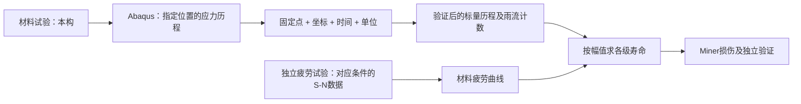

# 从应力历程到疲劳损伤：完整教学算例

> [!warning] 适用范围
> 本例全部材料参数和载荷均为虚构数值，目的是让你看懂每一步的数据和公式；它**没有运行 Abaqus、没有读取真实 ODB，也不是 PC/ABS 寿命预测**。两个载荷级的循环数是假定已经由经过核对的历程计数所得，并非本例运行雨流算法的输出。

## 1. 问题与计算路线

假设零件某一固定材料点承受可重复的载荷块。实际项目中，需要先通过材料试验建立本构，再用 Abaqus 求解，得到这个点在实际工况下的应力张量历程；另外用同牌号、同加工状态、匹配环境及失效判据的疲劳试验标定 S–N 数据。本例只展示数据已准备并验证后的疲劳算术。

## 2. 定义位置、工况和载荷块

假定位置是某个实体单元的一个积分点；应完整记录 ODB 文件、分析步、实例、单元号、积分点、坐标基底和时间。壳单元还需记录截面点。不得把每帧不同位置的最大值拼成一条历程；非比例多轴载荷也不能默认用某个应力分量代替材料验证过的疲劳指标。

假定该点经过验证，可用**固定方向的有符号单轴应力**表示疲劳驱动力，且某完整载荷块通过适当雨流规则得到：

| 载荷级 | 最小应力 MPa | 最大应力 MPa | 完整循环数 $n_i$ | 应力幅 $S_{a,i}$ MPa | 平均应力 MPa | $R$ |
|---|---:|---:|---:|---:|---:|---:|
| 1 | −10 | 10 | 1000 | 10 | 0 | −1 |
| 2 | −20 | 20 | 20 | 20 | 0 | −1 |

计算采用 $S_a=(\sigma_{max}-\sigma_{min})/2$、$\sigma_m=(\sigma_{max}+\sigma_{min})/2$、$R=\sigma_{min}/\sigma_{max}$。两个载荷级都为 $R=-1$。这里假设边界半循环已经按谱块重复方式妥善计数；真实雨流检测的残余不能静默丢弃，见 [[pyLife虚拟数据接口核验]]。

## 3. 假定疲劳曲线并求各级寿命

假设存在一条适用于同一材料、工况和失效判据的**虚构**单段曲线：

$$N_f(S_a)=10^6\left(\frac{10\,\mathrm{MPa}}{S_a}\right)^5.$$

它只是说明曲线映射，不是实验拟合结果，也没有概率保证。代入得到：

| 载荷级 | 计算 | 假定曲线对应的 $N_f$ |
|---|---|---:|
| 1 | $10^6(10/10)^5$ | 1,000,000 次 |
| 2 | $10^6(10/20)^5$ | 31,250 次 |

在本地 pyLife 2.3.1 中，用 `WoehlerCurve` 的 `k_1=5`、`ND=10^6`、`SD=10`，并显式设置 `k_2=5`，对 `[10, 20]` 调用 `basquin_cycles`，得到以上两个数。这里显式设置斜率只为了构造教学幂律；它不证明任何材料存在或不存在耐久极限。[pyLife 2.3.1 WoehlerCurve 文档](https://pylife.readthedocs.io/en/2.3.1/materiallaws/woehlercurve.html)。

### 3.1 输入前核对：应力幅、应力范围和单位

继续使用上面的**虚构**曲线和第1级循环。最小值 −10 MPa、最大值 10 MPa：应力范围 $\Delta\sigma=20$ MPa，而应力幅 $S_a=\Delta\sigma/2=10$ MPa。这条曲线以**幅值**为输入，所以正确结果为 $10^6$ 次。如果误将范围 20 当成幅值输入，同一曲线会输出 31,250 次，相差 **32 倍**；并不是 pyLife 自动判断了幅值还是范围，而是输入和曲线定义发生了错配。此 32 倍是本例斜率 $k=5$ 的结果，不是所有材料或曲线的固定误差倍数。

Abaqus 本身不规定单位体系：必须从建模时选用的自洽体系确认 ODB 应力单位。若该模型采用 N–mm 体系，且没有其他单位缩放，则应力单位为 N/mm²，也就是 MPa；若模型的应力单位为 Pa，同一物理幅值需要换算为 $10^7$ Pa。**载荷和曲线参数必须使用同一单位**：$10^7$ Pa 对应的 $S_D$ 应是 $10^7$ Pa，而不是 10 MPa 数字未换算地混用。单位未确定时停止计算并追溯模型输入，不能仅凭数值大小猜测。

本地 pyLife 2.3.1 的 `WoehlerCurve.basquin_cycles` 使用给定的数值和曲线参数，不会替用户补充物理单位或判定它们是否一致。软件接口和闭合循环的实际核验见 [[pyLife虚拟数据接口核验]]；算例中的 10 MPa 与 20 MPa 输入分别经该接口核得 $10^6$ 和 31,250 次。计算结果依旧是教学结果，不代表实际材料寿命。

### 3.2 循环次数与反转次数：不能只改列名

有些应变–寿命图的横坐标是 $2N_f$：对完整的、每周期包含两次应变反向的规则循环，$N_f$ 是完整循环数，$2N_f$ 是反转次数。例如 [[18 频率与自发热实验 — Mortazavian 2015博士论文#补读第9章：缺口应力、梯度与寿命|Mortazavian 博士论文图9-7、9-8]] 使用 $2N_f$ 横轴；不规则载荷及半循环还须按具体计数定义处理。

**虚构换算例子**：假定某段拟合采用 $\varepsilon_a=0.5(2N_f)^{-0.5}$；给定 $\varepsilon_a=0.005$，则 $(2N_f)^{0.5}=100$，因此 $2N_f=10{,}000$ 次反转、$N_f=5{,}000$ 个完整循环。如果把公式解出的10,000直接记作完整循环数，寿命会多报一倍。这只是数学定义检查，假设参数和曲线均为虚构值，不能当作塑胶的应变寿命定律。

把论文曲线移入另一个工具时，应保存原方程及横坐标约定，在指定参考点重新计算幅值和循环数后再拟合或换算参数；不能只把 `2N` 列改名为 `N`。对于应力–寿命与应变–寿命，均需确认幅值、载荷比、失效判据、温度及统计对象一致。

## 4. 计算单块损伤与重复块数

在**线性 Miner 规则**、各级按完整循环计数、失效阈值假定为 $D=1$、块间响应及曲线不变的前提下：

$$D_{block}=\sum_i\frac{n_i}{N_{f,i}}
=\frac{1000}{1{,}000{,}000}+\frac{20}{31{,}250}
=0.00164.$$

如果将同一个载荷块无限重复，按连续损伤近似折算：$1/D_{block}\approx609.76$ 块；每块 $1020$ 次完整循环，约为 $6.22\times10^5$ 次循环。实际发生阈值的精确循环取决于块内顺序与离散计数，不能把小数块当成已完成的物理试验；如果有残余半循环、预载或块间响应变化，还需重新分析。

该结果是**模型假设下的教学数**。线性 Miner 对同一组 $n_i$、$N_{f,i}$ 的总和不区分先高后低或先低后高；材料实际可能有顺序、温升、保载、蠕变与损伤演化。[[03 熵损伤与变幅载荷 — Li等 2024]] 和 [[17 短纤热塑性塑料疲劳准则比较 — Santharam等 2020]] 说明需要研究这些现象，但不能将其他材料的数值修正直接用于目标零件。

## 5. 故意改变一个条件：平均应力

将第 1 级改为 10–30 MPa：$S_a=10$ MPa、$\sigma_m=20$ MPa、$R=1/3$。如果仍然机械地只查上面的幅值曲线，得到的 $N_f$ 仍是 1,000,000 次；**这是方法未使用均值应力造成的结果，不是证明两种工况寿命相同**。要比较这两种情况，需要匹配 $R$ 的疲劳试验，或经过目标材料验证的均值应力方法；不能默认金属公式适用于塑胶。

同理，如果应力幅为 ±10 MPa 的正弦拉压历程被转换为非负 Mises，应力符号和反转会变化或丢失；不能假设它与单轴有符号历程可互换。详细例子见 [[塑胶疲劳仿真技术SOP — 工作稿#SOP-06A：先验证标量化能否保留拉压反转|SOP 标量化检查]]。

## 6. 真实项目必须补齐的证据

- **材料**：目标牌号、工艺和温度范围内的本构响应、疲劳试样原始数据、run-out 和离散。
- **有限元**：边界与反力对照，网格/时间/输出采样收敛，固定材料点与坐标核验，以及可能存在的温升和状态演化。
- **桥接**：真实 Windows/Abaqus ODB 的实体积分点和壳截面点读取验证。桥接首版的范围是筛选和导出数据，不代表寿命计算已实现。
- **后处理**：多轴或均值应力方法、循环残余规则、块重复方式与不确定性；用独立试样和零件测试验证失效位置、模式及寿命散布。

完整流程见 [[塑胶疲劳仿真技术SOP — 工作稿]]；材料和疲劳数据采集见 [[材料试验与疲劳标定 — 可执行方案]]。
