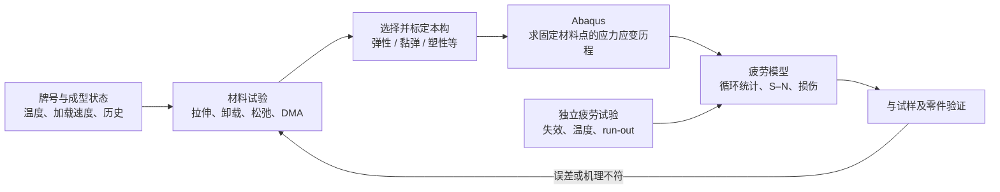

# 塑胶本构关系说明：从文献理解材料，再进入 Abaqus 建模

> **本说明的目的**：帮助你理解塑胶材料的力学响应、需要哪些实验、如何选择 Abaqus 本构，以及它与后续 pyLife 疲劳计算的关系。它整合已核对的文献正文和部分图表，不假装所有论文都已读完。本文公式若未特别说明，均以**一维、小应变、等温**为入门假设；数值例子均为虚构教学数据，不是 PC/ABS 的材料卡或设计值。
>
> 从 [[项目主页]] 进入；需要完整文献记录见 [[精读进度与证据台账]]，工程步骤见 [[塑胶疲劳仿真技术SOP — 工作稿]]。

## 一、先看全貌：为什么要建立本构关系？

本构关系回答：**给材料施加一段变形或载荷后，在当前时间和温度下，材料产生什么应力、应变以及可恢复或不可恢复变形？**

对于塑胶，结果通常不只取决于“现在拉到了多少”，还取决于**拉得有多快、以前怎样加载、保持了多久、材料有多热**。因此，一条室温、单一拉伸速度下的曲线往往不足以说明实际零件在循环、停顿、温升中的表现。

**两个模型要分清：**本构模型负责从载荷求局部力学响应；疲劳模型负责根据历程和疲劳数据估算损伤或失效。Abaqus 中填入一条拉伸曲线，不会自动得到塑胶的 S–N 曲线；pyLife 做了雨流计数，也不会自动识别真实塑胶的热失效或蠕变失效。

## 二、理解材料响应：五种现象

| 现象 | 实验上看到什么 | 物理含义和建模提示 |
|---|---|---|
| 弹性 | 缓慢加载后卸载，应变大致随应力返回 | 一部分能量可恢复；小范围内可先近似线弹性 |
| 应力松弛 | 拉到某个变形后保持，应变不变，应力随时间下降 | 材料内部响应随时间调整；仅用时间无关弹性无法描述 |
| 蠕变 | 保持载荷或应力，变形随时间增长 | 对预紧、卡扣保载和长时间服役很重要 |
| 滞回 | 周期加载与卸载曲线不重合，围成回线 | 每周期有机械能耗散；可能伴随温升或不可逆变化 |
| 不可恢复变形与循环演化 | 卸载后仍有残余应变，循环中峰值、刚度或回线形状变化 | 可能涉及塑性、黏塑性、损伤、温升或它们的组合，需实验区分 |

**图像化理解：**想象把一块塑胶拉长后固定住。线弹性模型认为应力保持不变；黏弹模型允许应力逐渐下降。如果松开后它不能完全恢复，单纯的线黏弹模型就可能不够。对于真实件，还应排查夹具滑移、温度变化和测量误差，不能仅凭一条曲线就判定唯一机理。

已核查的 Delrin POM 技术论文展示了拉伸、松弛、循环和温度依赖；它提供了这条实验思路，但其材料不是 PC/ABS。[[02 工程聚合物疲劳实现 — Volgers与Shojaei|文献精读：Volgers 与 Shojaei]]

## 三、最简单的起点：线弹性

在一维、小应变、线性且无历史效应的近似下：

$$\sigma=E\varepsilon$$

其中 $\sigma$ 为应力，$\varepsilon$ 为应变，$E$ 为弹性模量；例如 $E=2000$ MPa、$\varepsilon=0.005$ 时，$\sigma=10$ MPa。三维各向同性线弹性还需要泊松比 $\nu$；一般应在对应温度和测试速率下确定。

**适合何时作为基线？** 工作应变较小，卸载基本恢复；在实际载荷速度、温度和持续时间范围内，模量变化对结果影响经验证可以接受。它适合先检查几何、边界、接触和网格，但不能用来说明已经考虑了松弛、蠕变或循环退化。

## 四、弹性之后：塑性与黏塑性

若卸载后仍有较稳定的残余变形，需要考虑不可恢复变形。简单的一维概念分解为

$$\varepsilon=\varepsilon^e+\varepsilon^p.$$

$\varepsilon^e$ 是可恢复部分，$\varepsilon^p$ 是塑性部分。弹塑性模型需要初始弹性、屈服和屈服后的硬化/软化数据；若响应还明显依赖应变速率或保载时间，则需要评估黏塑性或其他时间相关模型。

**注意：**某次卸载后仍有应变，并不自动证明它永远无法恢复。塑胶可能同时存在延迟恢复、残余塑性、损伤和温度效应；应观察足够长的恢复时间，并用多速率、加载–卸载–保载实验验证。

对于大变形、拉压不对称、压力敏感、局部颈缩或温度接近转变区的情况，简单线弹性加金属常用塑性模型未必足够。Abaqus 中能否组合指定材料行为、其参数定义及求解器支持，须逐项查目标版本并做单元验证，不能只根据材料名称选模型。

## 五、黏弹性：把“时间”放进本构

### 5.1 松弛与蠕变

黏弹性可用弹簧和黏壶帮助理解：弹簧表示可恢复储能；黏壶表示速率相关的流动。它们是**模型元件**，不是对聚合物分子结构的一一对应。

一个弹簧 $E_1$ 与黏壶 $\eta_1$ 串联，构成 Maxwell 支路，特征时间为：

$$\tau_1=\frac{\eta_1}{E_1}.$$

如果理想地瞬间拉到 $\varepsilon_0$ 并保持，单支路的应力随时间衰减：

$$\sigma(t)=E_1\varepsilon_0 e^{-t/\tau_1}.$$

比如虚构 $E_1=1000$ MPa、$\eta_1=1000$ MPa·s，则 $\tau_1=1$ s；保持 1 s 后，单支路应力变为初值的 $e^{-1}\approx36.8\%$。真实材料往往有许多时间尺度，单支路不能覆盖所有实验时间。

### 5.2 广义 Maxwell 与 Prony 系列

将多个 Maxwell 支路与平衡弹簧并联，可表示不同速度的松弛：

$$E(t)=E_{\infty}+\sum_{i=1}^{m}E_i e^{-t/\tau_i},\qquad E(0)=E_{\infty}+\sum_iE_i.$$

这就是一维松弛模量的 Prony 型表达。在线性、小应变、等温、初始静止的条件下，任意应变历程可用叠加积分表示：

$$\sigma(t)=\int_0^tE(t-s)\dot\varepsilon(s)\,ds.$$

它表达的核心是：**当前应力由此前各时刻的应变变化共同决定**。理论推导、频率域公式和带单位例子见 [[线黏弹本构与耗散 — 推导和标定]]；Abaqus 的时域表述见[官方 2026 公开文档](https://docs.software.vt.edu/abaqusv2026/English/SIMACAEMATRefMap/simamat-c-timevisco.htm)。

**映射到 Abaqus 时不能直接照抄一维参数：**三维模型通常区分剪切松弛 $G(t)$ 与体积松弛 $K(t)$，也要确认使用瞬时模量还是长期模量。若只有 $E(t)$ 而泊松比随时间的变化未知，不能唯一确定 $G(t)$ 和 $K(t)$；应依据所选材料模型、实验和目标版本输入约定标定。

### 5.3 什么时候线性黏弹不够？

做相同温度、不同应变幅值的松弛实验。如果归一化响应曲线显著依赖幅值，或卸载有明显不可恢复变形、循环刚度持续变化、温升显著，那么线性黏弹的叠加假设就没有得到充分支持。下一步应根据实际现象评估非线性黏弹、弹塑性/黏塑性、损伤和热耦合，而不是一口气叠加所有模型。

[[09 有限黏弹性与Abaqus UMAT — Lefèvre等 2024|Lefèvre 等]]展示了一族弹性体大变形黏弹 UMAT，并用解析解做数值验证；其橡胶材料、内部变量与参数**不是**已验证的 PC/ABS 模型。论文内部变量更新用显式 Runge–Kutta，也不代表整个求解过程是 Abaqus/Explicit。

## 六、DMA、滞回和自发热有什么关系？

在稳态小幅正弦应变下，可用储能模量 $E'$ 和损耗模量 $E''$ 描述响应；$E'$ 对应同相刚度，$E''$ 对应与应变相差四分之一周期的耗散分量，常用损耗因子 $\tan\delta=E''/E'$。这些量随频率、温度和材料状态变化。

对于线性、稳态、等温近似的单轴正弦循环，单位体积每周期机械耗散为

$$W_d=\oint\sigma\,d\varepsilon=\pi E''\varepsilon_a^2.$$

频率为 $f$ 时，平均耗散功率密度为 $fW_d$。如果一部分转化为热，可以写出示意热平衡：

$$\rho c_p\dot T=\nabla\!\cdot(k_T\nabla T)+\dot q.$$

温度是否升高还取决于热源比例、导热、对流、接触、几何和材料热参数；不能简单地把所有机械耗散都视作即时热量。温度升高后，模量、损耗和失效机理也可能改变，形成反馈。

**文献怎么支持？** Volgers 等的 POM 试验在相近峰值应力下改变空气流动，观察到不同的局部温升与疲劳响应；这说明散热边界需要记录，但不提供任意 PC/ABS 的冷却修正系数。[[02 工程聚合物疲劳实现 — Volgers与Shojaei|查看图9复核]]；[[07 聚合物自发热与损伤判据 — Katunin 2019|自发热综述精读]]。

## 七、温度与时间：WLF 和时间–温度叠加

有些材料在一定范围内，不同温度下的松弛曲线可通过平移近似叠合。若这一“热流变简单”假设得到实验支持，可引入平移因子 $A(T)$ 和缩减时间：

$$\xi(t)=\int_0^t\frac{ds}{A(T(s))},\qquad
\log_{10}A(T)=-\frac{C_1(T-T_0)}{C_2+(T-T_0)}.$$

第二式是 WLF 的一种写法，$T_0$ 为参考温度，$C_1,C_2$ 要通过目标材料实验确定。[Abaqus 官方时域黏弹文档（2026版）](https://docs.software.vt.edu/abaqusv2026/English/SIMACAEMATRefMap/simamat-c-timevisco.htm)

这不是让实际零件“加快加载”的许可，也不会自动计算自发热。PC/ABS 是共混物，可能存在多个转变过程；要检查不同温度下曲线形状能否对齐，并限制在有数据支持的温度范围。相关计算例子见 [[线黏弹本构与耗散 — 推导和标定#5. 温度变化与时间–温度叠加|时间–温度知识卡]]。

## 八、材料试验如何支撑模型选择？

| 要回答的问题 | 建议收集的数据 | 用途 |
|---|---|---|
| 工程对象是什么？ | 牌号、批次、PC/ABS比例或供应商资料、成型温度、方向、厚度、表面、含湿与老化状态 | 确认试样和零件是否可比；不拿别的牌号数据代替 |
| 是否近似弹性？ | 目标温度、多个加载速率和幅值下的拉伸及卸载；保留原始力与位移/应变 | 得到初始刚度、非线性、残余与速率敏感性 |
| 时间效应有多大？ | 多幅值松弛、蠕变、卸载后恢复；必要时多频率 DMA | 判断线性黏弹假设，标定松弛时间及独立验证 |
| 循环是否稳定？ | 不同应力比和幅值的循环应力–应变、滞回面积、刚度、残余应变 | 判断循环演化和是否需要扩展模型 |
| 是否发生热失稳？ | 环境及试样实际温度历程、频率、散热和夹持条件 | 判断自发热及是否需要热–力分析 |
| 什么时候失效？ | 每件试样的上下限、波形、频率、温度、失效模式、循环数与 run-out | 建立条件匹配的 S–N/寿命数据，供 pyLife 等后处理 |

先确定工作范围再设计试验；实验个数、置信度、失效定义及验收误差由目标件要求预先确定。单轴和弯曲疲劳可参考 [ASTM D7791](https://store.astm.org/standards/d7791) 与 [ASTM D7774](https://store.astm.org/standards/d7774) 的正式有效文本；本说明不替代标准。

文献提醒：[[01 PC-ABS温度疲劳实验 — Mura 2018|Mura 等 PC/ABS论文]] 的疲劳数值在表格与图之间有冲突；[[04 PC-ABS-PMMA疲劳试验 — Kuleyin与Gümrük 2025|Kuleyin 等论文]] 的应力比定义存在歧义。这两篇能帮助设计试验，但其有争议的数字不能直接作为本项目材料卡。

## 九、在 Abaqus 中如何逐级落地？

1. **定义工况与失效**：明确真实时间、载荷或位移、温湿度、接触、预紧及允许的功能衰减；明确要预测起裂、断裂还是永久变形。
2. **建立材料基线**：先用适合工作应变的线弹性或其他最简单候选模型，验证单元、试样反力–位移曲线及基本边界。
3. **加入经实验支持的时间效应**：用松弛/蠕变/DMA数据拟合目标模型，检查参数单位、时间与温度范围；用未参与拟合的加载、保载、卸载记录验证。
4. **检查非线性与循环演化**：如果基线误差、残余变形或滞回明显，比较能否用适当的非线性、塑性、黏塑性等模型解释；先在单单元和试样验证，再进入零件。不能假设 Abaqus 中任意材料选项可以组合。
5. **选择求解器和真实时间**：Standard 与 Explicit 要按惯性、接触和载荷特征选择。对速率相关材料，不能简单缩短分析时间加速而不重新验证材料响应；质量缩放和能量也要检查。
6. **提取固定材料点历史**：根据模型保留实例、单元、积分点；壳还需保留截面点与坐标系。预先设置足够密的输出，并做采样收敛；默认 OdbClient 的位置和壳支持有限，见 [[ODB数据位置与pyLife接口 — 实体壳体核查]]。
7. **再接疲劳模型**：使用与材料、工况和失效定义匹配的疲劳数据；明确幅值、范围、平均应力和残余循环处理，再通过独立试样及零件验证。当前桥接工具首版需求是选择与导出数据，不是已经实现寿命计算。

## 十、已读文献能支持到什么程度？

| 文献及阅读入口 | 证据对象 | 可以学到什么 | 不能直接当成什么 |
|---|---|---|---|
| [[02 工程聚合物疲劳实现 — Volgers与Shojaei|Volgers 与 Shojaei]] | Delrin POM、实验与数值案例 | 速率、松弛、散热条件及模型变形路径验证 | PC/ABS 参数；已验证的完整热耦合寿命模型 |
| [[04 PC-ABS-PMMA疲劳试验 — Kuleyin与Gümrük 2025|Kuleyin 与 Gümrük，2025]] | 注塑 PC/ABS/PMMA，DMA、静态与疲劳 | 配方、频率、温度和循环回线需要一起记录 | 忽略应力比歧义后直接用于产品的设计曲线 |
| [[09 有限黏弹性与Abaqus UMAT — Lefèvre等 2024|Lefèvre 等，2024]] | 大变形各向同性弹性体 UMAT | 自由能、内部变量和积分算法的建模思路 | PC/ABS 材料标定；Explicit VUMAT 的现成实现 |
| [[03 熵损伤与变幅载荷 — Li等 2024|Li 等，2024]] 与 [[14 CFRP熵损伤与载荷顺序 — Deng等 2023|Deng 等，2023]] | 热固性基体和 CFRP 数值模型 | 历史、顺序和停顿可能对某些模型产生影响 | 目标塑胶实际寿命修正系数或变幅实验验证 |
| [[11 聚合物失效模式与频率 — Naga和El-Sayed 2024|Naga 与 El-Sayed，2024]] | HDPE 与 PVC 多种加载条件 | 区分热软化、蠕变与疲劳裂纹等失效方式 | 对所有塑胶的失效机制作统一定论 |

## 十一、阅读完后应该能回答

1. 在给定位移后保载，应力为什么可能下降？在给定应力下保载，为什么应变可能增长？
2. 哪些实验现象支持线弹性、线黏弹性，哪些现象提示还需塑性、黏塑性或热模型？
3. $E(t)$、$E'$、$E''$、$G(t)$ 分别是什么，为什么不能不加转换地互相代替？
4. 为什么同一个材料牌号还要记录温度、加载频率、成型工艺和取向？
5. Abaqus 输出局部响应后，为什么还必须准备独立疲劳数据和验证方案？

**当前未完成事项**：部分图表及缺失全文仍在核对；Abaqus 2024 的受限帮助页面、Windows 环境和真实 ODB 尚未实机验证。本说明不包含已经为用户牌号标定好的本构常数。
