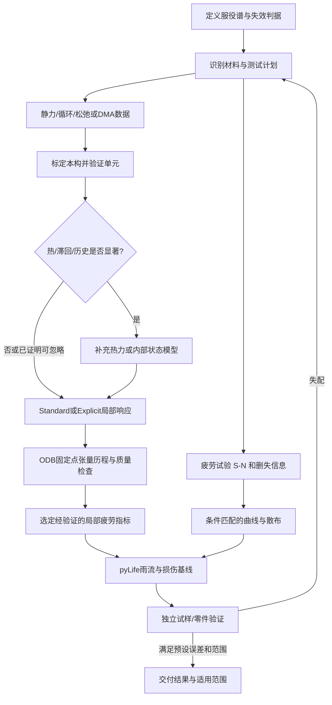

# 塑胶件 Abaqus + pyLife 疲劳仿真 SOP（工作稿）

> 本稿正在随文献精读和软件核验修订。未在用户Windows/Abaqus 2024/真实ODB上运行，也未产生真实材料寿命。步骤中的工程取舍是建议，验收阈值必须根据目标件和试验预先约定。材料参数必须来自匹配牌号、工艺及载荷环境的试验。

## 一、整体路线与分支

现有桥接PRD的首版仅到ODB数据和疲劳参数导出；雨流、损伤和寿命在后续软件阶段实现。上述是完整研究SOP，不是已实现的桥接工具功能。

## 二、物理与数学模型概览

| 物理问题 | 基线数学形式 | 主要假设 | 依据/进入后续步骤的条件 |
|---|---|---|---|
| 力学平衡 | $\mathbf M\ddot{\mathbf u}+\mathbf C\dot{\mathbf u}+\mathbf f_{int}(\mathbf u,\text{state})=\mathbf f_{ext}$ | 离散模型、边界与接触能描述工况 | [Abaqus显式动力学理论，2026公开版](https://docs.software.vt.edu/abaqusv2026/English/SIMACAETHERefMap/simathe-c-expdynamic.htm)；2024具体可用性待核验 |
| 黏弹松弛 | $G(t)=G_\infty+\sum_i G_i e^{-t/\tau_i}$，$\tau_i=\eta_i/G_i$ | 线性、小应变、等温入门形式；张量与有限应变需用对应模型 | [Abaqus时域黏弹，2026公开版](https://docs.software.vt.edu/abaqusv2026/English/SIMACAEMATRefMap/simamat-c-timevisco.htm)；用松弛/蠕变/DMA的独立数据验证 |
| 局部疲劳曲线 | $S_a=A N^b$ 或 $N=N_D(S_a/S_D)^{-k}$，$k=-1/b$ | 单段幂律、给定材料、工艺、温度、频率、R、失效定义和拟合区间 | [[04 PC-ABS-PMMA疲劳试验 — Kuleyin与Gümrük 2025]]；其R歧义未消除，不作输入 |
| 累积损伤基线 | $D=\sum_i n_i/N_i$ | 循环损伤独立线性叠加；临界$D$需要试验 | [[03 熵损伤与变幅载荷 — Li等 2024]]仅证明特定数值模型有顺序效应 |
| 能量/热 | $\rho c_p\dot T=\nabla\cdot(\kappa\nabla T)+\dot q$；稳态小幅正弦耗散 $W_d=\pi E''\epsilon_a^2$ | 热源构成、对流和接触边界须独立标定；公式仅在线性稳态等温近似下使用 | [[02 工程聚合物疲劳实现 — Volgers与Shojaei]]展示散热边界对试验的影响 |

## 三、SOP-01 定义工况与失效

**输入**：材料和工艺、几何、装配、载荷/位移谱、环境温湿度、频率、停顿、设计寿命和失效定义。若项目资料缺失，建立数据缺口清单，不用公开文献的参数冒充产品数据。

**操作**：区分起裂、断裂、永久变形或刚度/夹持力衰减；标记是否有预紧、接触、加载相位、服役小时与工况组合。记录试样与零件的对应失效判据。

**输出/检查点**：工况表、失效判据和目标误差；明确时间是物理时间还是静态加载参数。资料缺失时只允许教学演示。

## 四、SOP-02 材料表征与疲劳试验

**输入**：目标牌号、批次、注塑工艺、取向、试样与环境；试验条件及原始记录格式。

**操作**：先用多速率/温度单调及循环试验筛查，再视现象补充松弛、蠕变、DMA、测温和热学数据。单轴和弯曲疲劳分别参考[ASTM D7791](https://store.astm.org/standards/d7791)和[ASTM D7774](https://store.astm.org/standards/d7774)的正式有效文本；此处不是标准操作条件的替代品。记录每个试样的$\sigma_{max}$、$\sigma_{min}$、频率、波形、温度历程、失效和run-out。

**计算定义**：$\Delta\sigma=\sigma_{max}-\sigma_{min}$，$\sigma_a=\Delta\sigma/2$，$\sigma_m=(\sigma_{max}+\sigma_{min})/2$，$R=\sigma_{min}/\sigma_{max}$。保留真实上下限，避免分母为零及文献写法混淆。

**检查点**：量测链已校准、样本与条件完整；原始记录区分断裂/删失；选择与零件条件相匹配的数据。见[[01 PC-ABS温度疲劳实验 — Mura 2018]]和[[04 PC-ABS-PMMA疲劳试验 — Kuleyin与Gümrük 2025]]的数据冲突，不能直接将其数值作为设计输入。

试样记录、应力幅/范围、右删失似然与pyLife标记的数学说明见 [[疲劳试验数据与删失 — S-N拟合基础]]。

## 五、SOP-03 本构选择与标定

**输入**：多种加载/卸载/保载速率及温度下的应力—应变、松弛/蠕变/DMA数据。

**操作**：按现象比较线弹性、线黏弹、弹塑性/黏塑性；考虑拉压不对称、压力敏感、软化、棘轮及纤维方向。Abaqus中的模型组合必须按具体求解器、应变范围和版本核查；不要默认任意材料选项可叠加。[2026公开材料组合](https://docs.software.vt.edu/abaqusv2026/English/SIMACAEMATRefMap/simamat-c-matmodels.htm)

对各向同性线黏弹，将归一化剪切松弛表达为 $G(t)/G_0=1-\sum_i g_i(1-e^{-t/\tau_i})$；$g_i$无量纲，$\tau_i>0$。体积项需独立判断。明确输入弹性常数是瞬时还是长期，核查归一化约束和拟合时间窗口。

**检查点**：用未参加标定的数据复现加载、卸载、保载；形成误差、残差和有效时间/温度区间。若幅值导致归一化曲线变化明显，不应继续声称线性黏弹已验证。

## 六、SOP-04 Abaqus求解与数值验证

**输入**：几何、网格、材料、边界、实际载荷/接触、目标输出区域及物理时间。

**操作**：建立单元级与试样级基线，再建零件。低速稳定问题可比较Standard；高速、强接触或复杂非线性可考虑Explicit，求解器并非疲劳方法的固定前提。Explicit需要检查增量稳定、质量缩放、局部响应和能量；对速率相关材料，不能仅通过压缩分析时间提速而不改变物理。

网格和时间/输出间隔分别收敛：比较局部应力应变历程、极值、反力、接触状态和需要的温度；对点载荷、尖角等奇异点不得只报最大云图。壳单元记录法向与各截面点。

在建模输出阶段就指定目标区域、`S`及需要的温度/状态量、积分点和所需壳截面点，并确认截面类型可产生这些量。2026 公开文档中的 Explicit 默认场输出是**整个分析步20个区间**，不是每周期20帧；假如一步内有100个周期，这远不足以重建循环。要求记录实际输出时间并做采样收敛，而不是只增加求解增量。有关壳截面默认点、全部截面点输出选项及2024版本待核事项见 [[ODB数据位置与pyLife接口 — 实体壳体核查]]。

**检查点**：反力—位移与试样/零件实验一致到项目预设误差；显式情况下质量变化与动能、人工能量及局部峰值对比均经审核。可视化云图只能辅助检查，不能替代固定点时间序列验证。

## 七、SOP-05 ODB→pyLife 数据契约

**输入**：已稳定写完、版本兼容的ODB；选定的时间域步骤、实例、区域、帧及实体积分点/壳截面点。

**操作**：字段 $S$、必要时应变、温度和状态变量按实际输出位置读取。保留实例名、单元号、积分点、截面点、坐标基底、步/帧/时间、分量标签、源单位与数据有效性。不要把每帧不同位置最大值拼成一条假历程。记录场输出频率，处理缺帧/NaN/单元删除而不是补零。[Abaqus字段文档，2026公开版](https://docs.software.vt.edu/abaqusv2026/English/SIMACAECMDRefMap/simacmd-c-odbintroreadfieldpyc.htm)

**位置警示**：[OdbClient 2.3.1](https://pylife.readthedocs.io/en/2.3.1/tools/odbclient/odbclient.html)示例输出包含node_id/element_id；不等于已经保留积分点和壳截面点。桥接实现须明确其后端、输出位置及完整性，再与Abaqus抽查数值。

该版本 `variable(..., position=None)` 的文档还指出：原位置为积分点时，默认读取 `ELEMENT_NODAL`，而非直接保留积分点。若需要积分点，必须显式指定支持的位置，并检查实际返回的积分点和截面点标识；能否满足实体与壳单元的完整性尚需真实 ODB 验证。外推后的单元节点值与积分点值不能混称为同一个位置。

**壳单元的额外风险**：对 [2.3.1 服务端源码](https://github.com/boschresearch/pylife/blob/2.3.1/tools/odbserver/odbserver/interface.py)的静态检查显示，部分网格与集合查询限制实体单元，字段索引组装未显式包含截面点。不能将 OdbClient 当作已满足壳截面点要求的实现。可评估在 Abaqus Python 侧直接读取元信息并导出中间包；具体边界和验收案例见 [[ODB数据位置与pyLife接口 — 实体壳体核查]]。

**检查点**：单位/坐标明确、材料点键唯一、帧顺序和数据完整、抽查两个实例及不同壳截面点；粗细两种输出频率在疲劳指标上收敛。输出交换包和校验日志；PRD规定首版不做损伤计算。

## 八、SOP-06 逐点雨流与曲线

**输入**：固定材料点经验证的标量历程，或先行确定并验证的多轴指标；对应材料S–N数据。

**操作**：明确$S_a$或$\Delta S$、N或2N、$R$和材料曲线定义。多轴历程不能默认直接对非负Mises做雨流并保留全部拉压反转/相位信息。根据实际残余半循环和谱块重复方式选择计数规则；分块数据保留检测器状态。[pyLife 2.3.1雨流](https://pylife.readthedocs.io/en/2.3.1/stress/rainflow.html)

按真实试验记录拟合，断裂与run-out分开；拟合模型、分布、参数、散布和外推范围需记录。[pyLife 2.3.1拟合示例](https://pylife.readthedocs.io/en/2.3.1/demos/woehler_analyzer.html)可演示接口，但其阈值推断断裂状态不能代替原始记录。

pyLife `WoehlerCurve`的$k_2$缺省表示无限寿命段，散布也有默认值；对塑胶必须明确依据，不把软件默认值视作实验证据。[官方API](https://pylife.readthedocs.io/en/2.3.1/materiallaws/woehlercurve.html)

**手算检查**：若 $\sigma_{min}=10$、$\sigma_{max}=30$ MPa，则 $\sigma_a=10$ MPa、$\sigma_m=20$ MPa、$R=1/3$。若误将范围20 MPa当幅值，在 $k=5$ 的单段幂律下损伤被放大 $2^5=32$ 倍；该数字仅为定义检查。

**接口小例子**：[[pyLife虚拟数据接口核验]] 给出可运行脚本，检查雨流闭合循环、索引与虚拟 Wöhler 曲线。残余循环未计入示例的损伤小计，不作为完整寿命结果。

**检查点**：常幅正弦、残余半循环、数据块拼接和已知曲线的预期值均可复现；记录各环节软件版本与方法。实际实现必须另外测试。

## 九、SOP-07 损伤累计、映射与验证

对各循环级 $i$ 计算$N_i$，按候选Miner规则 $D=\sum n_i/N_i$；临界值、均值应力和多轴修正须基于目标材料验证。谱块寿命折算需保存真实块时长和重复规则。过程对单点实施，再按材料点键映射回网格，不能把不同材料点损伤互相混用。

独立验证依次比较：试样恒幅寿命和散布；两级/顺序/停顿工况；零件的刚度、局部应变、温升、失效位置与机理、寿命分布。单次寿命碰巧接近不能证明模型正确。

如果自发热、蠕变或强路径依赖超过预设误差，停止把当前S–N/Miner预测当成合格结论；补做试验并评估热—力耦合、循环演化或研究型损伤模型。

## 十、SOP-08 交付与可追溯性

至少交付：载荷/材料来源、单位和时间语义、材料本构与疲劳参数及拟合区间、求解器和版本、网格/输出收敛、ODB选择与坐标、循环统计规则、损伤模型和临界假设、验证样本、误差与适用边界、可复现日志。将材料试验数据、仿真预测和教学演示明确区分。

## 未完成的核验

- 用户的Abaqus 2024 帮助页面本轮因访问请求被拒绝，2026公开文档只是概念参考；2024版本的具体API/本构兼容性和输入格式仍须实机核验。
- 已运行[[pyLife虚拟数据接口核验|虚拟数据示例]]；未运行真实ODB、Windows环境或用户材料试验，不能视为项目寿命验证。
- 论文与图表仍按[[精读进度与证据台账]]继续核验；不能声称文献全部精读完毕。
