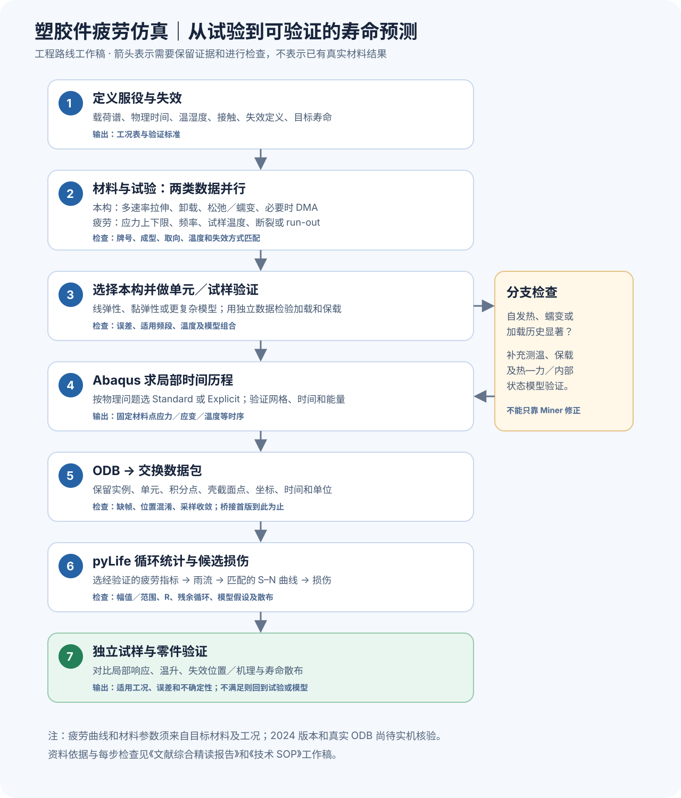
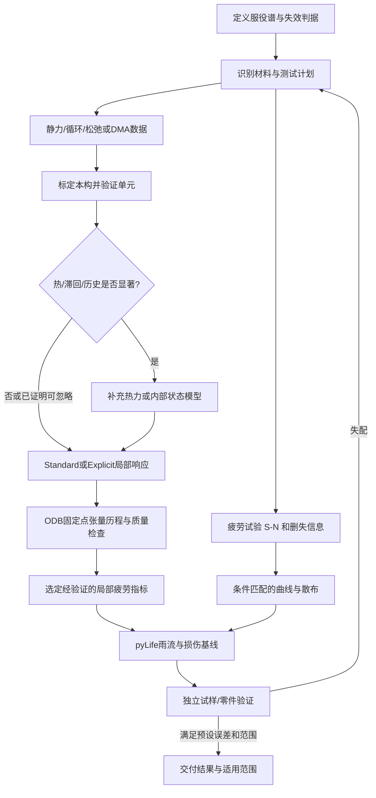

# 塑胶件 Abaqus + pyLife 疲劳仿真 SOP（工作稿）

> 本稿正在随文献精读和软件核验修订。未在用户Windows/Abaqus 2024/真实ODB上运行，也未产生真实材料寿命。步骤中的工程取舍是建议，验收阈值必须根据目标件和试验预先约定。材料参数必须来自匹配牌号、工艺及载荷环境的试验。

## 一、整体路线与分支

现有桥接PRD的首版仅到ODB数据和疲劳参数导出；雨流、损伤和寿命在后续软件阶段实现。上述是完整研究SOP，不是已实现的桥接工具功能。

## 二、物理与数学模型概览

| 物理问题 | 基线数学形式 | 主要假设 | 依据/进入后续步骤的条件 |
|---|---|---|---|
| 力学平衡 | $\mathbf M\ddot{\mathbf u}+\mathbf C\dot{\mathbf u}+\mathbf f_{int}(\mathbf u,\text{state})=\mathbf f_{ext}$ | 离散模型、边界与接触能描述工况 | [Abaqus显式动力学理论，2026公开版](https://docs.software.vt.edu/abaqusv2026/English/SIMACAETHERefMap/simathe-c-expdynamic.htm)；2024具体可用性待核验 |
| 黏弹松弛 | $G(t)=G_\infty+\sum_i G_i e^{-t/\tau_i}$，$\tau_i=\eta_i/G_i$ | 线性、小应变、等温入门形式；张量与有限应变需用对应模型 | [Abaqus时域黏弹，2026公开版](https://docs.software.vt.edu/abaqusv2026/English/SIMACAEMATRefMap/simamat-c-timevisco.htm)；用松弛/蠕变/DMA的独立数据验证 |
| 局部疲劳曲线 | $S_a=A N^b$ 或 $N=N_D(S_a/S_D)^{-k}$，$k=-1/b$ | 单段幂律、给定材料、工艺、温度、频率、R、失效定义和拟合区间 | [[04 PC-ABS-PMMA疲劳试验 — Kuleyin与Gümrük 2025]]；其R歧义未消除，不作输入 |
| 累积损伤基线 | $D=\sum_i n_i/N_i$ | 循环损伤独立线性叠加；临界$D$需要试验 | [[03 熵损伤与变幅载荷 — Li等 2024]]仅证明特定数值模型有顺序效应 |
| 能量/热 | $\rho c_p\dot T=\nabla\cdot(\kappa\nabla T)+\dot q$；稳态小幅正弦耗散 $W_d=\pi E''\epsilon_a^2$ | 热源构成、对流和接触边界须独立标定；公式仅在线性稳态等温近似下使用 | [[02 工程聚合物疲劳实现 — Volgers与Shojaei]]展示散热边界对试验的影响 |

## 三、SOP-01 定义工况与失效

**输入**：材料和工艺、几何、装配、载荷/位移谱、环境温湿度、频率、停顿、设计寿命和失效定义。若项目资料缺失，建立数据缺口清单，不用公开文献的参数冒充产品数据。

**操作**：区分起裂、断裂、永久变形或刚度/夹持力衰减；标记是否有预紧、接触、加载相位、服役小时与工况组合。记录试样与零件的对应失效判据。

**输出/检查点**：工况表、失效判据和目标误差；明确时间是物理时间还是静态加载参数。资料缺失时只允许教学演示。

### Abaqus 帮助文档的本地参考

用户提供的 Abaqus 2016 帮助已有本地离线副本与检索入口，位于 `~/Documents/Codex/Abaqus-2016离线帮助/`；双击其中的“打开离线检索.command”即可搜索已下载章节。22 本 PDF 手册已下载并通过首尾页面读取检查；部分页面的文字可能无法自动索引，应直接打开 PDF 查阅。来源：[时域黏弹性](http://130.149.89.49:2080/v2016/books/usb/pt05ch22s07abm12.html)、[显式动力学](http://130.149.89.49:2080/v2016/books/usb/pt03ch06s03at08.html)、[质量缩放](http://130.149.89.49:2080/v2016/books/usb/pt04ch11s06aus75.html)、[输出到 ODB](http://130.149.89.49:2080/v2016/books/usb/pt02ch04s01aus41.html)。

## 四、SOP-02 材料表征与疲劳试验

**输入**：目标牌号、批次、注塑工艺、取向、试样与环境；试验条件及原始记录格式。

**操作**：先用多速率/温度单调及循环试验筛查，再视现象补充松弛、蠕变、DMA、测温和热学数据。单轴和弯曲疲劳分别参考[ASTM D7791](https://store.astm.org/standards/d7791)和[ASTM D7774](https://store.astm.org/standards/d7774)的正式有效文本；此处不是标准操作条件的替代品。记录每个试样的$\sigma_{max}$、$\sigma_{min}$、频率、波形、温度历程、失效和run-out。

**计算定义**：$\Delta\sigma=\sigma_{max}-\sigma_{min}$，$\sigma_a=\Delta\sigma/2$，$\sigma_m=(\sigma_{max}+\sigma_{min})/2$，$R=\sigma_{min}/\sigma_{max}$。保留真实上下限，避免分母为零及文献写法混淆。

**检查点**：量测链已校准、样本与条件完整；原始记录区分断裂/删失；选择与零件条件相匹配的数据。见[[01 PC-ABS温度疲劳实验 — Mura 2018]]和[[04 PC-ABS-PMMA疲劳试验 — Kuleyin与Gümrük 2025]]的数据冲突，不能直接将其数值作为设计输入。

**保持时间与循环数分别记录**：恒载应力幅为零，按频率将恒载时长折算成“等效循环数”只是绘图或试验比较约定，不能当作实际应力反转输入雨流。[[11 聚合物失效模式与频率 — Naga和El-Sayed 2024#补读图 7–11：恒载蠕变和等寿命图如何衔接|原文图示例]]。有保载或预紧时，还需保留实际时间并另评估蠕变及恢复。

**频率与温升对照**：对目标材料在相同应力比、波形、环境及试样方向下设置多个频率，逐样记录温度历程、循环数和失效模式；进一步通过可控温或散热对照研究温升与速率的影响。若采用逐级频率方案，应记录同一试样的全部加载历史，不把各级视为独立样本。研究范例和局限见 [[18 频率与自发热实验 — Mortazavian 2015博士论文]]。

试样记录、应力幅/范围、右删失似然与pyLife标记的数学说明见 [[疲劳试验数据与删失 — S-N拟合基础]]。 同时保存停机原因，区分预定 run-out 与因异常提前终止；报告分位寿命时，不把它与参数置信下限混为一谈。 材料表征、疲劳和频率—散热对照的操作矩阵见 [[材料试验与疲劳标定 — 可执行方案]]。

## 五、SOP-03 本构选择与标定

**输入**：多种加载/卸载/保载速率及温度下的应力—应变、松弛/蠕变/DMA数据。

**操作**：按现象比较线弹性、线黏弹、弹塑性/黏塑性；考虑拉压不对称、压力敏感、软化、棘轮及纤维方向。Abaqus中的模型组合必须按具体求解器、应变范围和版本核查；不要默认任意材料选项可叠加。[2026公开材料组合](https://docs.software.vt.edu/abaqusv2026/English/SIMACAEMATRefMap/simamat-c-matmodels.htm)

对各向同性线黏弹，将归一化剪切松弛表达为 $G(t)/G_0=1-\sum_i g_i(1-e^{-t/\tau_i})$；$g_i$无量纲，$\tau_i>0$。体积项需独立判断。明确输入弹性常数是瞬时还是长期，核查归一化约束和拟合时间窗口。

**拉伸数据换算**：采用需要真实应力—塑性应变的表格模型时，按所选模型、加载条件及数据定义处理，不能将工程总应变直接复制为塑性应变；[[塑胶本构关系说明 — 从文献到Abaqus建模#拉伸数据转塑性输入：一个有前提的例子|条件、公式与算例]]。

**材料组合门槛**：本机手册的组合表对 `*ELASTIC` + `*VISCOELASTIC` 排除塑性行为及相关增强项；不得随意叠加 `*PLASTIC`。若试验表明可恢复时间效应和不可恢复变形均重要，按 [[塑胶本构关系说明 — 从文献到Abaqus建模#5.2.1 松弛和永久变形都有时，不能任意叠加材料选项|模型选择步骤]]重新评估，并做最小单元及独立试验验证。

**输入默认值检查**：与时域黏弹性联用时，本机关键词手册将省略 `MODULI` 解释为长期模量；若提供瞬时模量应明确写出对应选项。两种等价输入及误用后的手算对照见 [[线黏弹本构与耗散 — 推导和标定#4.2 同一材料的瞬时和长期输入，以及遗漏参数的后果|材料卡默认值示例]]。

材料卡的行顺序与瞬时/长期模量的教学核对见 [[线黏弹本构与耗散 — 推导和标定#4.1 三维 Prony 参数：一个可以手算的材料卡例子|三维 Prony 材料卡示例]]；参数为虚构值，不能用于产品。

**检查点**：用未参加标定的数据复现加载、卸载、保载；形成误差、残差和有效时间/温度区间。 数据按试样与必要的制造批次划分，避免同一试样的不同时间段同时作为标定与独立验证；详见 [[材料试验与疲劳标定 — 可执行方案#4.3 标定与独立验证如何分开|试验分组]]。若幅值导致归一化曲线变化明显，不应继续声称线性黏弹已验证。

## 六、SOP-04 Abaqus求解与数值验证

**输入**：几何、网格、材料、边界、实际载荷/接触、目标输出区域及物理时间。

**操作**：建立单元级与试样级基线，再建零件。低速稳定问题可比较Standard；高速、强接触或复杂非线性可考虑Explicit，求解器并非疲劳方法的固定前提。Explicit需要检查增量稳定、质量缩放、局部响应和能量；对速率相关材料，不能仅通过压缩分析时间提速而不改变物理。

网格和时间/输出间隔分别收敛：比较局部应力应变历程、极值、反力、接触状态和需要的温度；对点载荷、尖角等奇异点不得只报最大云图。壳单元记录法向与各截面点。

在建模输出阶段就指定目标区域、`S`及需要的温度/状态量、积分点和所需壳截面点，并确认截面类型可产生这些量。2026 公开文档中的 Explicit 默认场输出是**整个分析步20个区间**，不是每周期20帧；假如一步内有100个周期，这远不足以重建循环。要求记录实际输出时间并做采样收敛，而不是只增加求解增量。有关壳截面默认点、全部截面点输出选项及2024版本待核事项见 [[ODB数据位置与pyLife接口 — 实体壳体核查]]。

[[输出采样与疲劳漏计 — 教学例子]] 用一个可手算的100周期正弦展示：在特定采样相位下，整步20个区间甚至会把真实10 MPa幅值采成近似零。

**检查点**：反力—位移与试样/零件实验一致到项目预设误差；显式情况下质量变化与动能、人工能量及局部峰值对比均经审核。可视化云图只能辅助检查，不能替代固定点时间序列验证。

### 输出规划：局部历程与全场如何配合

1. **先定问题和位置**：先用试样结果、粗网格及关键结构判断候选区域；为每个候选区域建立明确的实例、单元、积分点和壳截面点身份。热点位置可能随载荷改变，不能只用一次静态云图保证覆盖全部热点。
2. **场输出与历程输出分工**：场输出适合较大区域的空间分布，可用于确认热点是否转移；历程输出适合少量位置的高频采样，可用于检查波形。所选方向或多轴准则需要哪些应力分量，应在提交计算前定义；场输出通常按完整基本变量请求，历程可按分量请求。记录实际可用的位置和分量，不因名称相似就把两类数据视为完全相同。
3. **评估规模**：历程输出的每个张量分量、每个积分点都可能产生独立请求。本地手册以 C3D10M 的 S 张量为例：6 个分量 × 4 个积分点 = 24 个历程请求，并提示大量请求可能影响性能。截面点、单元与区域数也会增加规模；先在小模型计数，再决定输出范围。来源：本地 `PDF手册/ANALYSIS_1.pdf` 第 648–649 页；封面与页脚版本标记不一致，见本地使用说明，实际版本须验证。
4. **按时间历程验收，不只看请求设置**：例如一个分析步包含 100 个周期，整步设 20 个输出区间，平均每 5 个周期才出现一个间隔，无法保证识别每次反转。比较更细间隔的同一固定点历程，核对峰谷、雨流循环和累计指标；对于变幅或短脉冲，单凭平均每周期采样点数仍不足以证明捕获全部转折。场与历程的输出时刻可能不完全相同，应使用各自实际时间坐标。
5. **可追溯交付**：保存输出请求、步时长、实际时间点、位置标识、抽查图和采样收敛结果；如缺少必要转折，调整输出并重新求解，后处理不能恢复未写入 ODB 的真实响应。

本机分析手册第 653–655 页还描述 Explicit 的场和历程输出频率选项、近似时间标记及默认间隔；这是来源记录，不代替目标 Abaqus 2024 环境的操作验证。

### SOP-04A：Explicit 加速策略的逐项验证

**目的**：在保留工况物理意义的前提下比较效率，而不是以计算完成或云图平滑作为准确的证明。以下为基于 [Abaqus 2026 质量缩放官方说明](https://docs.software.vt.edu/abaqusv2026/English/SIMACAEANLRefMap/simaanl-c-massscaling.htm) 的验证流程；2024 版本的设置和输出名称需要实机核对。

1. **先判断是否允许准静态近似。** 对缓慢卡扣变形等问题，先核验惯性相对于内部力是否可忽略；冲击、共振、快速接触及结构振动问题要保留真实质量与载荷频率，不适用仅凭低速准静态假设的加速方案。显式算法能处理动态，不意味着问题本身一定是准静态。
2. **记录基线。** 用真实几何、材料和实际载荷—时间曲线运行可承受的参考模型或关键试样，并记录求解步长、总质量、加载点反力—位移、目标点应力/应变时程、接触状态、动能/内能及损伤相关输出。准静态 Standard 对照只有在材料、接触与边界均可等价表达时才有意义。
3. **先查控制成本的网格和接触。** 查看状态文件中控制稳定增量的小单元；改善畸形或不必要的小单元，但要重新进行网格收敛。若仍需质量缩放，固定真实加载时间，从保守数值开始逐级比较，并记录实际增加的全局和局部质量。供应商说明质量缩放可维持自然时间尺度，但增加惯性，适用性必须对具体结果验证。
4. **做对照而不是只看单一能量比。** 比较基线与每个候选在反力、局部历程极值/相位、接触切换、热点位置和雨流结果的差异；同时审查动能、内部能量、人工能量及质量变化的时间历程。能量比在内部能量接近零时可能不稳定；低全局动能也不能排除局部动态误差。容许误差应由项目事先确定，不能套用一个放之四海皆准的比例。
5. **若打算缩短加载时间，必须重新证明材料响应不变。** 虚构一维 Maxwell 支路：$\tau=1$ s、加载至同一应变。若加载时间从 2 s 缩短至 0.2 s，加载结束时支路响应系数由约 0.432 增至约 0.906；这说明加载速率本身改变了应力，即使惯性小也不是同一材料工况。完整推导与条件见 [[线黏弹本构与耗散 — 推导和标定#2.1 真实加载斜坡为什么不能忽略？|加载斜坡算例]]。
6. **形成结论。** 仅在候选方案相对于可信参考的各项偏差均符合项目预设标准、温度和失效机理不变的条件下，记录适用范围并使用该加速方案。任何材料参数随温度变化或试样自发热明显时，必须另核热边界与耦合，不能只凭质量缩放解决。

稳定增量与单元尺度、波速和质量变化的物理关系及虚构数值示例见 [[塑胶疲劳文献综合精读报告 — 工作稿#Explicit 稳定增量与质量缩放：一个量纲算例|Explicit 稳定增量算例]]；它只能解释量级，不能替代求解器状态文件和收敛检查。

稳定时间增量、ODB 输出帧间隔和载荷周期是三个不同量：减小求解增量不自动提高 ODB 输出频率，详见 [[输出采样与疲劳漏计 — 教学例子]]。

## 七、SOP-05 ODB→pyLife 数据契约

**输入**：已稳定写完、版本兼容的ODB；选定的时间域步骤、实例、区域、帧及实体积分点/壳截面点。

**操作**：字段 $S$、必要时应变、温度和状态变量按实际输出位置读取。保留实例名、单元号、积分点、截面点、坐标基底、步/帧/时间、分量标签、源单位与数据有效性。不要把每帧不同位置最大值拼成一条假历程。 [[ODB数据位置与pyLife接口 — 实体壳体核查#1.1 手算：逐帧最大值为什么可能消掉循环|两点示例与软件核验]]说明这样做可能消掉全部反转。记录场输出频率，处理缺帧/NaN/单元删除而不是补零。[Abaqus字段文档，2026公开版](https://docs.software.vt.edu/abaqusv2026/English/SIMACAECMDRefMap/simacmd-c-odbintroreadfieldpyc.htm)

**坐标方向检查**：即使固定同一积分点，旋转局部基底也可能使分量变化；应按疲劳准则确定固定方向或材料随动方向，再统一比较。[[ODB数据位置与pyLife接口 — 实体壳体核查#1.2 固定材料点不等于固定坐标：旋转坐标的例子|坐标旋转的手算例子]]。

**位置警示**：[OdbClient 2.3.1](https://pylife.readthedocs.io/en/2.3.1/tools/odbclient/odbclient.html)示例输出包含node_id/element_id；不等于已经保留积分点和壳截面点。桥接实现须明确其后端、输出位置及完整性，再与Abaqus抽查数值。

该版本 `variable(..., position=None)` 的文档还指出：原位置为积分点时，默认读取 `ELEMENT_NODAL`，而非直接保留积分点。若需要积分点，必须显式指定支持的位置，并检查实际返回的积分点和截面点标识；能否满足实体与壳单元的完整性尚需真实 ODB 验证。外推后的单元节点值与积分点值不能混称为同一个位置。

**壳单元的额外风险**：对 [2.3.1 服务端源码](https://github.com/boschresearch/pylife/blob/2.3.1/tools/odbserver/odbserver/interface.py)的静态检查显示，部分网格与集合查询限制实体单元，字段索引组装未显式包含截面点。不能将 OdbClient 当作已满足壳截面点要求的实现。可评估在 Abaqus Python 侧直接读取元信息并导出中间包；具体边界和验收案例见 [[ODB数据位置与pyLife接口 — 实体壳体核查]]。

**精度与壳厚度应变**：核对 ODB 中变量的实际存储精度，避免将节点双精度设置误认为所有积分点应力都已提高精度；导出为双精度文本也不能恢复写出时丢失的峰谷。本机手册对 Standard 某些平面应力/壳场输出还提示 E33 可能报告零而真实厚度应变并非零。[[ODB数据位置与pyLife接口 — 实体壳体核查#输出精度与壳厚度应变：不要把存储值直接等同真实量|数值示例和资料位置]]；目标 2024 环境与具体变量尚待验证。

**能量输入核对**：使用剪切应变时必须确认张量或工程剪应变约定；VUMAT 与 UMAT 的接口约定不同，不能直接推断任意 ODB 字段。[[线黏弹本构与耗散 — 推导和标定#3.2 剪切耗散：张量剪应变和工程剪应变不能混用|小变形功密度手算]]展示漏掉系数2的后果；大变形需进一步核对功共轭与体积定义。

**幅值和单位核对**：记录雨流结果是上下限、范围还是幅值，并确认疲劳曲线的横坐标定义一致；确认 ODB 单位体系，再将应力和疲劳曲线全部换算到同一单位。幅值/范围混用的数值后果见 [[从应力历程到疲劳损伤 — 完整教学算例#3.1 输入前核对：应力幅、应力范围和单位|教学算例]]。

**检查点**：单位/坐标明确、材料点键唯一、帧顺序和数据完整、抽查两个实例及不同壳截面点；粗细两种输出频率在疲劳指标上收敛。输出交换包和校验日志；PRD规定首版不做损伤计算。

## 八、SOP-06 逐点雨流与曲线

**输入**：固定材料点经验证的标量历程，或先行确定并验证的多轴指标；对应材料S–N数据。

**操作**：明确$S_a$或$\Delta S$、N或2N、$R$和材料曲线定义。多轴历程不能默认直接对非负Mises做雨流并保留全部拉压反转/相位信息。根据实际残余半循环和谱块重复方式选择计数规则；分块数据保留检测器状态。 [[pyLife虚拟数据接口核验#分块处理：跨块状态不能丢失|已运行的分块例子]]展示了每块新建检测器如何漏掉跨块闭合循环。[pyLife 2.3.1雨流](https://pylife.readthedocs.io/en/2.3.1/stress/rainflow.html)

**物理谱块重复要单独核验**：分文件处理的分块不是物理载荷块的重复。使用实际拼接波形与边界处理检查跨块闭合及起止残余，不把单块的已闭合计数直接乘重复数。[[pyLife虚拟数据接口核验#重复谱块：不能把单块的已闭合循环直接乘次数|已运行示例]]说明误差来源；材料响应随循环变化时，还需验证载荷块对应的局部响应是否可重复。

按真实试验记录拟合，断裂与run-out分开；拟合模型、分布、参数、散布和外推范围需记录。[pyLife 2.3.1拟合示例](https://pylife.readthedocs.io/en/2.3.1/demos/woehler_analyzer.html)可演示接口，但其阈值推断断裂状态不能代替原始记录。

**先审查拟合分区**：pyLife 2.3.1 的 `FatigueData` 默认分区受最高 run-out 载荷影响，同一载荷级的破坏记录可能不进入 `finite_zone` 回归；转折值只是算法初值，不是已经证明的耐久极限。先打印逐件数据及分区，结合试验和所选分析器说明划分依据，必要时做敏感性分析。[[疲劳试验数据与删失 — S-N拟合基础#4.1 自动分区可能改变拟合样本：已运行的例子|查看本地运行例子]]。

[[pyLife虚拟数据接口核验#曲线默认值：无限输出不等于试验确定的无限寿命|已运行的默认值对照]]显示：同一虚构曲线低幅输入可因默认分支得到 `inf`；缺省散布也会让不同概率曲线重合。

pyLife `WoehlerCurve`的$k_2$缺省表示无限寿命段，散布也有默认值；对塑胶必须明确依据，不把软件默认值视作实验证据。[官方API](https://pylife.readthedocs.io/en/2.3.1/materiallaws/woehlercurve.html)

**均值修正的输入与默认值**：应先匹配试样曲线的 $R$，并用目标材料多应力比试验选择和验证修正模型。pyLife 2.3.1 的 FKM-Goodman 接口若未提供 `M2`，会使用 `M/3`；此约定不代表塑胶材料参数已知。[[从应力历程到疲劳损伤 — 完整教学算例#5.1 pyLife 的均值修正会怎样改变这个例子？|虚构的两组循环与已运行对照]]显示系数会显著改变结果。

**循环数约定**：部分文献的应变–寿命图使用 $2N_f$ 反转次数；输入按完整循环计数的工具前需换算。[[从应力历程到疲劳损伤 — 完整教学算例#3.2 循环次数与反转次数：不能只改列名|换算示例]]。

**探索能量模型时先冻结取值时间**：若指标取自实测寿命中点，事前并不知道这个时间点。若改用固定早期循环或时间窗口，应明确预测是在该时刻仍存活条件下进行，并单独报告窗口前失效的试样；分组、冻结与前瞻验证步骤见 [[材料试验与疲劳标定 — 可执行方案#4.4 探索能量型模型时，如何避免提前使用失效信息|能量模型验证方案]]。这是一项候选试验方案，尚未验证适用于本项目。

**缺口与疲劳曲线匹配**：先确认曲线使用名义应力还是局部应力、适用的几何和试样；有限元局部应力已包含的几何集中不能再无依据重复放大。最大点直接用于光滑材料曲线也不自动可靠，需要验证梯度、网格与尺寸效应。[[18 频率与自发热实验 — Mortazavian 2015博士论文#补读第9章：缺口应力、梯度与寿命|缺口试验和手算例子]]。

**手算检查**：若 $\sigma_{min}=10$、$\sigma_{max}=30$ MPa，则 $\sigma_a=10$ MPa、$\sigma_m=20$ MPa、$R=1/3$。若误将范围20 MPa当幅值，在 $k=5$ 的单段幂律下损伤被放大 $2^5=32$ 倍；该数字仅为定义检查。

**接口小例子**：[[pyLife虚拟数据接口核验]] 给出可运行脚本，检查雨流闭合循环、索引与虚拟 Wöhler 曲线。残余循环未计入示例的损伤小计，不作为完整寿命结果。

**检查点**：常幅正弦、残余半循环、数据块拼接和已知曲线的预期值均可复现；记录各环节软件版本与方法。实际实现必须另外测试。

### SOP-06A：先验证标量化能否保留拉压反转

对固定坐标的一维拉压教学例子，设 $\boldsymbol\sigma(t)=\mathrm{diag}(s(t),0,0)$、$s(t)=10\sin(\omega t)$ MPa，则偏应力 $\boldsymbol s=\boldsymbol\sigma-\tfrac13\mathrm{tr}(\boldsymbol\sigma)\mathbf I$。按 [Abaqus 定义的 Mises 不变量](https://docs.software.vt.edu/abaqusv2026/English/SIMACAEOUTRefMap/simaout-c-std-elementintegrationpointvariables.htm)，$q=\sqrt{\tfrac32\boldsymbol s:\boldsymbol s}=|s|$。

这意味着真实应力完成一个 $+10\to-10\to+10$ MPa 周期时，非负 Mises 历程是 $10\to0\to10\to0\to10$ MPa。若只在正负峰值采样，Mises 全为 10 MPa，反转完全消失；若同时采到过零点，Mises 则出现两次 $0\to10\to0$ 变化，频率是原来的两倍。两种情况都不能直接与以有符号单轴 $R=-1$ 标定的 S–N 曲线混用。

**处理步骤：**（1）保存原始张量及坐标基底；（2）确定与试样标定量、失效机制一致的标量或多轴疲劳方法；（3）在单轴拉压、纯剪、不同相位及旋转主方向的合成历程上验证循环结果；（4）在对应材料试样下独立验证，再用于零件。单轴固定方向案例可用有符号轴向应力，但这不是一般多轴载荷的通用解。

Abaqus/Standard 2026 文档还定义了以应力张量迹决定符号的 `S_MISES`；不同载荷状态下迹可能为零或发生符号变化，且压力敏感、非比例加载及材料疲劳机理并未因此自动解决。具体版本、求解器和输出支持须另核，不能把“加一个符号”当成已经验证的塑胶多轴疲劳准则。

从固定材料点、两级循环到 S–N 和 Miner 的虚构算术链条见 [[从应力历程到疲劳损伤 — 完整教学算例]]；此例不读取真实 ODB。

## 九、SOP-07 损伤累计、映射与验证

对各循环级 $i$ 计算$N_i$，按候选Miner规则 $D=\sum n_i/N_i$；临界值、均值应力和多轴修正须基于目标材料验证。谱块寿命折算需保存真实块时长和重复规则。过程对单点实施，再按材料点键映射回网格，不能把不同材料点损伤互相混用。

独立验证依次比较：试样恒幅寿命和散布；两级/顺序/停顿工况；零件的刚度、局部应变、温升、失效位置与机理、寿命分布。单次寿命碰巧接近不能证明模型正确。

如果自发热、蠕变或强路径依赖超过预设误差，停止把当前S–N/Miner预测当成合格结论；补做试验并评估热—力耦合、循环演化或研究型损伤模型。

## 十、落地示例：从 ODB 到可审查的数据包

本节是**建议的数据约定**，不是已实现的 ODB 导出器或 Abaqus 2024 操作截图。先用一个固定材料点贯通，再扩展到多个实体和壳点；不要先导出全模型海量数据而无法追踪每条记录。

### 10.1 准备一个最小核验工况

1. 指定一个分析步、一个实例、一个实体单元积分点，以及（若模型包含壳）一个壳单元的两个不同截面点。保留其 CAE 中的应力分量与帧时间截图或导出值作独立对照。明确材料取向或坐标系；若坐标随变形转动，要保留基底或完成已验证的坐标变换。
2. 求解前根据真实载荷周期、目标误差和输出收敛设计场输出；记录步内时间与实际帧时间。对于同一物理加载，增加输出密度重新评估极值与雨流结果，直到满足项目自定的收敛标准。[Abaqus 字段输出读取](https://docs.software.vt.edu/abaqusv2026/English/SIMACAECMDRefMap/simacmd-c-odbintroreadfieldpyc.htm)明确不同变量可按不同频率输出，因此不能假设每帧都有应力或温度。
3. 求解结束后检查文件已完整写入，记录源文件名称、哈希值、Abaqus版本和单位制。Abaqus 数值本身依赖用户采用一致单位制；不要依据数值大小自动推断 MPa 或秒。

### 10.2 数据包字段：一行一个位置、一个时刻

以下为建议逻辑字段；具体存储格式与 API 映射应由桥接程序实现并测试。

| 字段组 | 建议字段 | 必须检查 |
|---|---|---|
| 来源与步骤 | `source_id`, `step_name`, `frame_index`, `step_time` | 帧的物理时间单位；跨步总时间规则另存；不得把多个步骤简单假定连续 |
| 材料点 | `instance`, `element_label`, `position`, `integration_point`, `section_point` | 按位置保留适用字段；实体无截面点时应明确为不适用，壳截面点不可被省略；节点或外推值不能冒充积分点 |
| 状态与基底 | `element_type`, `section_description`, `coordinate_system` | 分量顺序、局部坐标、壳法向或铺层方向可追溯；基底随时间变化时需携带每帧变换信息 |
| 张量 | `S11`, `S22`, `S33`, `S12`, `S13`, `S23` 或完整分量标签与数值 | 不同单元可能缺少部分分量，缺失不等于零；标识原始组件、单位和读取位置 |
| 可选同步量 | `temperature`, `strain`, `state_variables` | 记录对应位置和时间；不能直接把不同输出频率的数值按行合并。若插值须注明方法和误差，不能凭空补零 |
| 质量记录 | `validity`, `missing_reason` | 每个材料点在同一步内的时间严格递增；重复键、缺帧、NaN、删单元或截面点变化需报告，不得静默修复 |

建议唯一键为 `source_id + step_name + frame_index + instance + element_label + position + integration_point + section_point`，按实际输出位置定义“不适用”的明确标识；对节点值应另加节点标签等对应标识，不能套用积分点键。先验证键唯一性，再按**除时间和帧外的材料点身份**分组生成历程。示例字段设计并不证明 `OdbClient` 可直接提供全部字段，壳截面点必须在目标版本实测。

### 10.3 从张量到寿命：可手算的边界案例

仅以经过验证的单轴、固定方向有符号 $S_{11}$ 为例：若某个完整循环的最小和最大应力为 $-10$、$+10$ MPa，则 $S_a=10$ MPa、$S_m=0$、$R=-1$。假设相同条件的一条**虚构** S–N 曲线在 $S_a=10$ MPa 时给出 $N_f=10^6$ 次，则两个完整循环的 Miner 损伤小计 $D=2/10^6=2\times10^{-6}$。这只检查单位、幅值和累计算术，不预测材料的真实寿命；剩余半循环也尚未计入。

本库 [[pyLife虚拟数据接口核验]] 使用虚拟历程 `[0, 10, -10, 10, -10, 10, -10, 0]`，调用 pyLife 2.3.1 的三点检测器和 `FullRecorder`，已在 macOS Python 环境核对得到两个闭合循环及该损伤小计，并显示未闭合残余。正式计算需根据**实际边界条件和谱块重复方式**定义残余循环处理方式，不能把该小计当总损伤。[pyLife 2.3.1 文档](https://pylife.readthedocs.io/en/2.3.1/stress/rainflow.html)指出其检测器可分块处理，同时会丢弃 NaN 并使样本索引失效；工程流程应在调用前报错并调查缺失原因。

**验收判据**：至少对一个实体积分点和两个壳截面点，逐帧核对时间、分量、位置及基底；对不同输出密度比较极值和雨流损伤；检查输出包键、单位、缺帧日志及残余规则。所有这些都必须在 Windows、目标 Abaqus 2024、实际 ODB 上另行执行，当前尚无实机通过证据。

### 10.4 各阶段应留下什么，未通过时如何处理

| 阶段 | 至少保存的输出 | 未通过时的下一步 |
|---|---|---|
| 工况与失效 | 零件工况、载荷时间史、环境、失效判据与缺口清单 | 补测或标记假设；缺失关键条件时不宣称适用 |
| 本构 | 原始数据、试样信息、标定参数和独立验证误差 | 复查加载历史、单位与模型假设；必要时补试验或换模型 |
| 有限元 | 模型版本、输入文件、求解日志、网格/时间/输出收敛和试样反力对比 | 排查边界、接触、网格及惯性；热点不收敛时不报单点寿命 |
| ODB 数据 | 带材料点键与时间的交换包、单位及坐标说明、缺失与抽样核验日志 | 停止后续计算，修正输出请求或读取方法；不得补零掩盖缺失 |
| 疲劳模型 | 逐样本破坏/删失与停机原因、拟合数据和分区、曲线定义及其适用区间 | 补充对应工况或调整统计方法；缺乏依据时不外推出可靠度 |
| 结果验证 | 历程与计数、损伤假设、试样和零件对比、误差与限制 | 分析材料、热状态、载荷与失效机制；结果未验证时明确标注探索性 |

这些是实施和审查的记录要求，并不表示已有真实试验数据、ODB 桥接或零件寿命验证。

## 十一、SOP-08 交付与可追溯性

至少交付：载荷/材料来源、单位和时间语义、材料本构与疲劳参数及拟合区间、求解器和版本、网格/输出收敛、ODB选择与坐标、循环统计规则、损伤模型和临界假设、验证样本、误差与适用边界、可复现日志。将材料试验数据、仿真预测和教学演示明确区分。

## 未完成的核验

- 用户的Abaqus 2024 帮助页面本轮因访问请求被拒绝，2026公开文档只是概念参考；2024版本的具体API/本构兼容性和输入格式仍须实机核验。
- 已运行[[pyLife虚拟数据接口核验|虚拟数据示例]]；未运行真实ODB、Windows环境或用户材料试验，不能视为项目寿命验证。
- 论文与图表仍按[[精读进度与证据台账]]继续核验；不能声称文献全部精读完毕。
