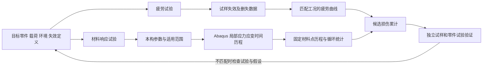

# 塑胶件疲劳仿真：文献综合精读报告

> [!warning] 阅读状态
> 本报告整合已读文献和相关软件资料，作为项目首版阅读与建模依据；部分原文、图表和 Abaqus 2024 页面尚未取得或核完。已获取文献的实际逐页阅读范围见 [[精读进度与证据台账]]；其他条目如未取得全文，不作为已精读。参数仅用于解释原文，不作为目标零件的材料卡或设计许用值。

## 1. 先回答三个工程问题

**材料为什么不能只给一个弹性模量？** 聚合物应力受时间、温度、应变幅值、制程及循环历史影响。松弛/蠕变试验说明时间依赖；循环滞回意味着能量耗散；较大的变形或不可恢复应变可能需要非线性或黏塑性。应先通过材料实验判断足够的模型复杂度，不能一开始就把任意大变形橡胶 UMAT 套到 PC/ABS。[[09 有限黏弹性与Abaqus UMAT — Lefèvre等 2024|Lefèvre 等]] 证明了一个弹性体 UMAT 与解析解的数值一致，不证明它对 PC/ABS 成立。

**为什么不能只看 S–N 曲线？** 蠕变、热软化和裂纹扩展可能在不同条件下主导失效。[[11 聚合物失效模式与频率 — Naga和El-Sayed 2024|Naga 和 El-Sayed]] 观测到 HDPE 与 PVC 在所测条件下出现不同失效方式；[[07 聚合物自发热与损伤判据 — Katunin 2019|Katunin]] 讨论循环自发热。设计试验时必须记录实际试样温度、频率、应力比和失效类型。材料、试样与工况不匹配时，已有曲线只能启发试验，不能作为设计许用。

**Abaqus 和 pyLife 各解决什么？** Abaqus 计算给定材料、边界、工况下的时空响应；ODB 保存相应输出。pyLife 提供雨流、载荷谱和 Wöhler 等计算工具。材料疲劳模型、应力标量化方法、温度适用性、累积损伤规则与有效性需要工程师和实验共同确定；软件本身不验证这些物理假设。具体操作顺序见 [[塑胶疲劳仿真技术SOP]]。

### 1.1 先抓住两条数据链

对一个待分析的塑胶卡扣或支架，先要知道它受到怎样的载荷、处在什么温度下，以及“失效”指断裂还是夹持力不足。然后并行建立两类数据：一类决定材料在载荷下**如何变形**，另一类决定规定循环下**何时失效**。

| 环节 | 需要实际测量或记录的东西 | 软件能做什么 | 交接前必须回答 |
|---|---|---|---|
| 材料响应 | 目标牌号和工艺下的加载、卸载、保载、恢复、温度及时间 | Abaqus 按所选本构计算材料与结构响应 | 参数是否覆盖零件的应变、时间和温度；模型能否复现未参与拟合的试验？ |
| 疲劳试验 | 每件试样的载荷上下限、频率、温度、失效或 run-out、循环数及判据 | pyLife 可辅助拟合和处理循环数据 | 曲线是否与零件的应力比、材料、工艺及失效定义匹配？ |
| 仿真到计数 | 固定材料点的应力分量、时间、坐标、单元与壳截面点 | Abaqus 保存 ODB；导出后 pyLife 可做雨流计数 | 是否记录了足够的转折；均值、单位、位置和材料曲线的应力定义是否一致？ |
| 预测与验证 | 独立试样和零件的响应、温度、失效位置与寿命 | 依所选规则累计损伤，形成待验证的结果 | 残余循环、失效阈值和模型适用性是否明确；是否有独立验证？ |

例如，[[26 PC-ABS相容剂与循环拉伸疲劳 — Ma等 2022|Ma 等]]提供了理解循环应变演化的实验例子；[[08 FFF工艺与PC-ABS疲劳 — Rodrigues等 2026|Rodrigues 等]]的逐试样表帮助理解 S–N 与 run-out。两篇的材料和工艺都不能直接替代目标零件的数据。详细步骤和未通过时的处理见 [[塑胶疲劳仿真技术SOP]]。

## 2. 从证据到工程决策

| 问题 | 原文对象与可用证据 | 可以借鉴 | 不能直接推出 |
|---|---|---|---|
| 温度如何影响疲劳？ | [[01 PC-ABS温度疲劳实验 — Mura 2018|Mura 等]]：注塑 ABS/PC-ABS，多个温度 | 工况与温度匹配；记录散热和试样温升 | 任意材料的温度修正系数；表2与图中具体数值存在冲突 |
| 循环试验怎么记录？ | [[04 PC-ABS-PMMA疲劳试验 — Kuleyin与Gümrük 2025|Kuleyin 等]]：注塑板切样、5 Hz | 配方、加工方向、滞回和应力水平必须完整留档 | 文中 $R$ 反写问题未解决前不可直接搬运参数 |
| 配方和循环变形如何关联？ | [[26 PC-ABS相容剂与循环拉伸疲劳 — Ma等 2022|Ma 等]]：PC/ABS 相容剂与拉伸循环 | 记录应变峰谷、加载比例及断口；区分黏弹恢复与永久变形 | 以各配方屈服强度比例加载的寿命可直接当作相同绝对应力比较或设计系数 |
| 加工方式有多重要？ | [[08 FFF工艺与PC-ABS疲劳 — Rodrigues等 2026|Rodrigues 等]]：FFF PC-ABS，±45°，10 Hz；存在 run-out | 记录制造方向和孔隙，将未断裂数据按删失处理；区分热分析指标 | FFF 曲线适用于注塑；有限 run-out 证明无限寿命；TGA 特征温度足以证明长期无降解 |
| 平均应力和频率影响什么？ | [[11 聚合物失效模式与频率 — Naga和El-Sayed 2024|Naga 等]]：HDPE 和 PVC | 同时识别裂纹、热软化、蠕变，不能只记录断裂循环数 | HDPE 及 PVC 的结果可直接定量代表 PC/ABS |
| 如何建立数值本构？ | [[02 工程聚合物疲劳实现 — Volgers与Shojaei|Volgers 等]]：POM；[[09 有限黏弹性与Abaqus UMAT — Lefèvre等 2024|Lefèvre 等]]：弹性体 | 单元级验证、真实时间尺度、实验标定与网格/步长收敛 | POM 或橡胶参数、UMAT 实现直接适用于 PC/ABS 或 Explicit |
| 变幅和停顿有何风险？ | [[03 熵损伤与变幅载荷 — Li等 2024|Li 等]]：热固性基体单元；[[14 CFRP熵损伤与载荷顺序 — Deng等 2023|Deng 等]]：纤维/树脂单胞 | 次序、停顿和材料状态可能影响累计损伤，设计顺序验证试验 | 模拟中的寿命修正比例适用于热塑性零件；Deng 文中不同模型给出不同趋势，需独立试验 |
| 平均应力与循环蠕变 | [[16 循环蠕变与能量疲劳准则 — Raphael等 2019|Raphael 等]]：PA6.6短玻纤的循环试验 | 测量平均应变增长、能量和温度；关注失效模式 | 使用寿命中点提取的指标已经构成独立前瞻预测；系数适用于PC/ABS |
| 多因素疲劳模型如何验证？ | [[17 短纤热塑性塑料疲劳准则比较 — Santharam等 2020|Santharam 等]]：480次PA66 GF50试验 | 对比载荷比、方向和环境，记录模型拟合范围及散布 | 温度与湿度的独立影响已被分别识别；拟合数据的三倍带表现等同零件前瞻精度 |
| 裂纹已存在怎么办？ | [[10 PC-ABS裂纹扩展与注塑工艺 — Ho等 2015|Ho 等]]：注塑紧凑拉伸试样、Paris 拟合 | 区分起裂寿命、扩展寿命，必要时测 $da/dN$ | 摘要模温 55°C 与正文 80°C 可互换；未经核实单位和原始试验条件的参数可用于设计 |
| 能否简化大量循环？ | [[06 黏弹性多时间尺度降阶 — Rodriguez等 2024|Rodriguez 等]]：一维多时间尺度降阶 | 先识别快慢时间尺度，再核验误差和计算代价 | 自由度减少必定更快；一维验证即证明适用于 3D 零件 |
| 表面数据如何使用？ | [[12 ABS表面形貌与处理 — Deninno等 2022|Deninno 等]]：蚀刻形貌表征 | 记录表面状态、测量尺度与处理 | 该文提供表面粗糙度对疲劳寿命的定量规律 |

**如何判断拟合图是否可靠？** [[08 FFF工艺与PC-ABS疲劳 — Rodrigues等 2026#补读第 9–10 页：两点拟合和寿命散布|Rodrigues 等的图 3–4]]中，部分低周线各只有两个点，却报告 $R^2=1$；两参数直线能穿过两个点，因此这一拟合度不能证明曲线具有预测能力。该文同标称应力级 PC 试样存在明显寿命差异。项目需要逐样本数据、失效/删失状态、重复及独立验证，而不只保存拟合曲线。

**比较疲劳曲线要固定循环数。** [[08 FFF工艺与PC-ABS疲劳 — Rodrigues等 2026#补读图 7–13：怎样比较疲劳曲线和缺陷|Rodrigues 等]]引用的两条 Nylon 12 幂律斜率不同：将相同的 $10^5$ 次循环代入，按文中印出的公式分别得到约 12.66 和 31.31 MPa；较高的截距不保证该循环数下的应力范围更高。两篇试验的工艺、加载和有效区间还需核实，这只是公式的算术比较，不是材料强度的最终排序。

**追溯引用能发现表格错误被继续使用。** [[08 FFF工艺与PC-ABS疲劳 — Rodrigues等 2026#追溯参考文献20：45.2 与 4.7 MPa 不宜直接作倍率比较|Rodrigues 等]]将其 FFF 试样的 4.7 MPa 应力范围与 Mura 等表中 45.2 MPa 比较，但 Mura 原表与其图中约 11.5 MPa 不一致；两个研究的制造、频率及应力定义也不同。不能据此判定打印件疲劳强度下降约十倍。

### 2.1 断口图怎样进入证据链

[[01 PC-ABS温度疲劳实验 — Mura 2018|Mura 等]]的图 11–18 展示了 PC/ABS 与 ABS 在不同温度下的代表性断口及生长带。图像能支持作者对相应试样裂纹形貌的观察，但没有给出每一条带对应的循环数或全部样本的量化统计，不能直接反推出裂纹扩展速率；作者对高温表面形貌与软化关系的解释也需要与温度及力学测量共同验证。项目试验记录应把断裂位置、断口、温度和循环响应结合，而不是仅保存最后的失效循环数。[原文 PDF 第8–12页](https://www.mdpi.com/1996-1944/11/10/1818)。

**同名参数的单位检查：** [[02 工程聚合物疲劳实现 — Volgers与Shojaei#参数同名但量纲相反：论文与 Abaqus 的 $D_1$|Volgers 论文与本机 Abaqus 手册]]的 Mooney–Rivlin 体积项都使用 $D_1$，但一个是乘数、一个是分母；在相同状态下的数值互为倒数，量纲也不同。不能按名称直接复制参数。

### 2.2 材料子程序验证和产品寿命验证的区别

[[09 有限黏弹性与Abaqus UMAT — Lefèvre等 2024|Lefèvre 等]]先将单元均匀加载结果与其精确解比较，再检查球壳有限元压力随网格细化向参考解收敛；最后展示理想化双相橡胶的加载与保载响应。这些算例支持论文实现对所选方程和边界问题的数值一致性，但不等于 PC/ABS 材料已标定，也没有给出零件疲劳寿命的实验验证。项目应沿用“材料点—试样—零件”的验证层级，并且分别检查材料响应和寿命预测。

## 3. 物理模型：从材料响应到寿命

### 3.1 小应变黏弹基线

在一维、线性、等温且初始静止的前提下，Boltzmann 叠加可写为 $\sigma(t)=\int_0^t E(t-\tau)\dot\varepsilon(\tau)d\tau$，松弛模量可近似为 $E(t)=E_\infty+\sum_i E_i e^{-t/\tau_i}$，其中 $E_i\ge0$、$\tau_i>0$。这不是任意非线性塑料的通用关系。三维材料卡通常还涉及剪切与体积响应，不能把一维 $E(t)$ 系数直接当成剪切 Prony 系数；应按 Abaqus 目标模型的规范与试验确定。技术参考：[Abaqus 时域黏弹性公开版](https://docs.software.vt.edu/abaqusv2026/English/SIMACAEMATRefMap/simamat-c-timevisco.htm)。

**直接相关的 PC/ABS 证据：** [[20 PC-ABS黏弹实验与Maxwell模型 — Yin和Wang 2012|Yin 与 Wang]]在95 ℃比较不同比例 PC/ABS 的 DMA 和松弛响应，并用一维广义 Maxwell 模型拟合。该研究有助于理解两类测试怎样互相校验，但其经验修正没有证明可迁移至目标材料；目前只读到正文索引，原图和附件未取得。

**标定中的可识别性：**实际松弛试验存在加载斜坡，若支路时间常数与加载时间接近或更短，保载开始前已发生明显松弛。对线性斜坡的卷积推导及可核算示例见 [[线黏弹本构与耗散 — 推导和标定#2.1 真实加载斜坡为什么不能忽略？|加载斜坡算例]]。拟合应使用实际应变—时间数据；针对超出仪器和数据覆盖范围的快速支路，需说明不可辨识性而非只报告高拟合优度。

**材料模型组合的限制。** 本机 Abaqus 手册的材料组合表对 `*ELASTIC` + `*VISCOELASTIC` 排除塑性行为及相关增强项。因此，试验同时显示松弛与不可恢复变形时，不能假设直接叠加 `*PLASTIC` 就得到所需模型；选型和试验验证路径见 [[塑胶本构关系说明 — 从文献到Abaqus建模#5.2.1 松弛和永久变形都有时，不能任意叠加材料选项|本构说明]]。

**追溯模型所用的原始 PC 试验。** [[29 PC单轴棘轮原始试验 — 黄婧依等 2015|黄婧依等]]比较了加载—恢复、应变/应力控制循环及保载，展示同一材料的响应随时间和历史变化。后续 [[28 PC循环黏弹黏塑本构 — Zhu等 2016正文核查|Zhu 等本构论文]]说明大部分试验结果先前发表于该文，因此两篇不应当作完全独立的验证数据。黄文的棘轮指标公式和单调拉伸速率的图文表述存在待核疑点；不能直接搬用图表数值。

**从单轴扩展到纯扭转。** [[30 PC纯扭转棘轮与恢复 — Lu等 2020|Lu 等]]的薄壁 PC 试样显示剪切恢复、保载及载荷历史与循环响应相关，试验中 DIC 未用于实时闭环控制，实际控制量是扭角。纯扭转能补充单轴证据，但不证明任意多轴或 PC/ABS 零件的寿命；论文的等效剪应力及应变必须按其定义换算。

**蠕变—恢复怎样辅助区分模型分量？** [[31 PA6黏弹黏塑标定与时温叠加 — Koyanagi等 2021|Koyanagi 等]]以 PA6 的恢复曲线外推黏塑应变，再结合松弛数据拟合黏弹部分；作者同时承认固定夹持位移不代表试样应变严格不变。这个例子解释了试验如何服务模型分解，但残余应变的判定和时温叠加都依赖假设，模型亦不含疲劳损伤，不能直接用于 PC/ABS 寿命预测。该文图 4 与图 5 的时间轴存在可能的秒/小时差异，尚待原始数据确认，见精读笔记。

**速率相关塑性不等于疲劳模型。** [[22 PC-ABS动态拉伸与本构反演 — Zhou等 2024|Zhou 等]]用 PC/ABS 多速率/温度单次拉伸反演经验塑性参数，并比较高速拉伸和穿透响应；它不能直接提供循环松弛或 S–N 寿命。已核图7–9及表1、3；热响应表为理论与仿真值，不能当作直接测温。高速率曲线有局部偏差，完整误差与参数冻结情况仍需核实。

**大变形后不能混淆应力定义。** [[23 循环加载后的PC-ABS拉伸与局部变形 — Fang等 2008|Fang 等]]利用两方向图像估计颈缩截面和真实轴向应力，说明初始截面的名义应力与当前截面平均应力不同。其试验是在拉伸中插入少量循环后拉断，不能视为恒幅疲劳寿命数据库；目前原PDF与图表尚待核对。

### 3.2 载荷、耗散与热平衡

对单轴正弦循环：$\sigma_m=(\sigma_{\max}+\sigma_{\min})/2$，$\sigma_a=(\sigma_{\max}-\sigma_{\min})/2$，常用 $R=\sigma_{\min}/\sigma_{\max}$，需核实每篇论文定义。在温度稳定、线性黏弹和正弦应变下，$W_d=\oint\sigma d\varepsilon=\pi E''\varepsilon_a^2$；频率为 $f$ 时的平均力学耗散功率密度为 $fW_d$。若某部分 $\beta$ 转化为热，简化热方程为 $\rho c\dot T=\nabla\!\cdot(k\nabla T)+\beta fW_d$，并需给定初温、导热与表面对流条件。$E''$、$\beta$ 和散热可能随温度与状态变化；热源与应力并非独立。[[07 聚合物自发热与损伤判据 — Katunin 2019|来源和原文公式疑点]]。

**散热对照需要看清载荷是否相同。** [[02 工程聚合物疲劳实现 — Volgers与Shojaei#补核图 1–10：作者如何从材料响应走到散热问题|Volgers 的图 9–10]]同时测量试样温度和载荷：图 9 的静止/循环空气峰值接近但不完全相同；图 10 比较相近寿命时峰值分别约 44 和 55 MPa。两图共同提示散热的重要性，但后者不能作为固定应力下仅改变通风的对照。

**频率与自发热的试验启示。** [[18 频率与自发热实验 — Mortazavian 2015博士论文|Mortazavian 博士论文第7章]]在短玻纤 PBT 和 PA6 上比较恒频与逐级频率试验；其稳态经验关系 $\Delta T=Bfw$ 将每周期耗散 $w$ 与单位时间热源联系起来。图7-7中阶梯试验与恒频对照的部分点存在差异；频率试验的滞回面积来自另行试验估算，温升和寿命的相关性不能证明单一因果，也不能把该研究的温升观察当成 PC/ABS 通用阈值。

**频率影响不必然同向。** [[21 PC-ABS加载频率与热软化 — Lee等 2026摘要核查|Lee 等2026摘要]]对特定 PC/ABS 报道频率提高对应其定义的疲劳极限升高，并将其归因于速率强化；[[18 频率与自发热实验 — Mortazavian 2015博士论文|Mortazavian 博士论文]]则在特定增强材料条件下观察到伴随温升的寿命下降。材料及指标不同，这提示应同时测量速率响应和自发热，不能预设频率影响方向。Lee 等全文尚未取得，其数值不用于材料卡。

**如何读温升阈值。** [[07 聚合物自发热与损伤判据 — Katunin 2019#原图复核：不同损伤指标不提供同一个阈值|Katunin 图15、19及表1]]显示，不同残余性能和损伤检测指标对应的特征温度不同；其温度—寿命示例同时改变载荷，不能把差异完全归因于温度。追溯原始试验后，3 ℃差异可能发生在同一标称组内；缺少逐样本数据，无法确认具体比较，原文图号也有疑点。

**应力控制与应变控制的换算**：在单轴线性稳态条件下，应力幅已知时应使用损耗柔量 $J^{\prime\prime}=E^{\prime\prime}/[(E^\prime)^2+(E^{\prime\prime})^2]$，每周期耗散 $W_d=\pi J^{\prime\prime}\sigma_a^2$。不能把损耗模量直接与应力幅平方相乘当作热源；该区别、单位手算及文献原式待核原因见 [[07 聚合物自发热与损伤判据 — Katunin 2019#追溯参考文献并比较应力控制与应变控制|自发热精读]]。

### 3.3 从 S–N 到谱损伤

在给定应力比、温度、频率、制造工艺和失效定义下，用 $\sigma_a=A N_f^{-b}$ 作为有限区间的经验 Basquin 表达。pyLife Wöhler 的斜率参数常写 $k_1=1/b$，对应 $N_f=N_D(S_D/\sigma_a)^{k_1}$，但幅值/范围、拐点 $N_D,S_D$ 和数据拟合区间必须一致。单一 run-out 只是到试验终止仍未破坏，不证明无限寿命；默认的无限耐久和无离散假设也不应当自动接受。[pyLife 2.3.1 WoehlerCurve](https://pylife.readthedocs.io/en/2.3.1/materiallaws/woehlercurve.html)。

**软件分区不是物理结论。** pyLife 2.3.1 的自动有限区划分会受最高 run-out 载荷影响；在一个已运行的虚构例子里，与 run-out 同载荷的破坏试样被分至另一组，没有进入 `finite_zone`。因此要先检查实际用于拟合的逐件数据，不能把自动转折值当作塑胶的实测耐久极限。[[疲劳试验数据与删失 — S-N拟合基础#4.1 自动分区可能改变拟合样本：已运行的例子|数据与结果]]。

雨流计数把适当的一维标量历程分解为循环，线性 Miner 基线 $D=\sum_i n_i/N_f(S_i)$，在 $D=1$ 作为假定失效阈值时估算重复谱块寿命。它不显式考虑顺序、保载、温升与状态演化；均值应力修正、应力标量化与材料数据需要另行验证。[[03 熵损伤与变幅载荷 — Li等 2024|变幅与停顿的模拟例子]] 支持进行顺序效应验证，不能给出普适修正量。[pyLife 2.3.1 雨流文档](https://pylife.readthedocs.io/en/2.3.1/stress/rainflow.html)。

**恒载时间不能伪装为循环。** [[11 聚合物失效模式与频率 — Naga和El-Sayed 2024#补读图 7–11：恒载蠕变和等寿命图如何衔接|Naga 和 El-Sayed]]在等寿命图中将恒载蠕变时间按参考频率折算为 $R=1$ 的等效循环数；它是时间轴换算，不是实际出现的应力反复。若零件有预紧或保持，必须保留真实时间并单独验证蠕变/恢复与循环的共同作用，不能将折算数直接送入雨流计数。

**过载次序的直接线索。** [[25 PC-ABS过载与裂纹扩展滞后 — Fang等 2007摘要核查|Fang 等2007摘要]]在 PC/ABS 裂纹试样中报告单次过载后扩展速率暂时降低并逐渐恢复；线性 Miner 对相同循环集合不含此类状态记忆。这是有裂纹扩展的摘要级证据，不能直接量化无裂纹零件总寿命误差。

**经验模型的拟合与验证边界**：[[17 短纤热塑性塑料疲劳准则比较 — Santharam等 2020|Santharam 等]]以同一数据集比较多个疲劳准则。作者的 IDAFIP 蠕变能—循环能形式在数据集中报告 96.5% 的结果落在三倍寿命带内，但其输入取自寿命中点，且论文明确侧重数据归并而非独立预测能力比较。该结果不能解释为 PC/ABS 零件预测准确率；若探索能量型模型，必须先验证 Abaqus 是否能得到匹配的循环应变和能量，再用独立工况评估。

**循环增长率的时间单位要核实。** [[16 循环蠕变与能量疲劳准则 — Raphael等 2019#作者稿原图复核：两个需要澄清的单位和符号|Raphael 等的作者稿]]将增长率写作每循环平均应变斜率，却在归一化参考量中标注 $\mathrm{s}^{-1}$；原文约定需进一步澄清。不同频率下不能把每循环值直接当成每秒值，或未经确认复制模型系数。

**能量指标不能混用。** Santharam 等定义的循环能 $W_c=\tfrac12\Delta\sigma\Delta\varepsilon$ 可以在理想线弹循环中为正，而闭合滞回面积 $W_h$ 为零；[[17 短纤热塑性塑料疲劳准则比较 — Santharam等 2020#手算：循环能指标不等于滞回耗散|虚构算例]]说明为什么不能把每一种“循环能量”都直接当成热源。

**缺口应力不等于完整的疲劳评价。** [[18 频率与自发热实验 — Mortazavian 2015博士论文#补读第9章：缺口应力、梯度与寿命|Mortazavian 博士论文第9章]]比较了缺口 PBT/PP 的有限元、经验缺口修正和临界距离方法；所示局部峰值直接套光滑曲线产生明显保守偏差。应先统一名义/局部应力的曲线定义，并以目标试样验证梯度和尺寸效应，不可直接套用其 $K_f$ 或距离。

### 3.4 裂纹扩展与多时间尺度

已知裂纹问题可在满足模型假设及测试支持的区间，用 $da/dN=C(\Delta K)^n$ 描述中间扩展区，积分估算从 $a_0$ 至 $a_c$ 的扩展循环数。$\Delta K$ 常随裂纹长度和几何变化；这一寿命不包含起裂阶段。[[10 PC-ABS裂纹扩展与注塑工艺 — Ho等 2015|原文试验与局限]]。

[[24 PC-ABS裂纹扩展初期尾部 — Fang等 2008公开片段|Fang 等公开片段]]特别提醒，裂纹扩展初期的“尾部”不能直接当作扩展阈值；完整图表和载荷细节尚未取得，不能以摘要中的系数做产品计算。

从裂纹初始尺寸到临界尺寸的 Paris 积分、量纲及与 S–N 总寿命避免重复计算的例子，见 [[裂纹扩展寿命与S-N寿命 — 何时使用及手算]]。

百万循环有限元全历程可能成本过高。模型降阶、代表性循环或载荷块重复都是候选，必须检查内部变量、温升及损伤是否跨块变化；[[06 黏弹性多时间尺度降阶 — Rodriguez等 2024|Rodriguez 等一维降阶研究]]展示的单尺度与多尺度位移和内部变量曲线接近，但作者报告所示算例中单尺度更高效。文中的约89%时间自由度减少不等于墙钟时间下降89%，也不能据此证明真实三维件能加速；研究代码和数据仍待取得。

### 3.5 求解器、物理时间与本构记忆

Abaqus/Explicit 通过条件稳定的时间积分计算动力平衡，准静态问题中也可使用，但其计算加速不应改变材料时间尺度。[Abaqus 2026 质量缩放文档](https://docs.software.vt.edu/abaqusv2026/English/SIMACAEANLRefMap/simaanl-c-massscaling.htm)指出：对速率相关准静态问题，质量缩放可保留自然加载时间，但增加质量也会改变惯性；动态问题尤其依赖真实质量。文献中的黏弹松弛及温升现象说明，单纯将实际循环压缩到更短时间会改变加载速率与材料内部状态。应按 [[塑胶疲劳仿真技术SOP#SOP-04A：Explicit 加速策略的逐项验证|SOP 对照验证]]，分别比较反力、局部应力历程、惯性和疲劳指标，而非只看一张云图或单一全局能量比例。

#### Explicit 稳定增量与质量缩放：一个量纲算例

动力平衡可概括为 $\mathbf M\ddot{\mathbf u}=\mathbf f_{ext}-\mathbf f_{int}$；显式中心差分通过已知状态逐步更新，稳定性限制随系统频率变化。对均匀、各向同性线弹体的简化估计，纵波速度与单元穿越时间可写为

$$c_d=\sqrt{\frac{K+4G/3}{\rho}},\qquad \Delta t_{est}\approx\frac{L}{c_d}.$$

$K,G$ 分别为体积模量和剪切模量，$\rho$ 为密度，$L$ 是代表性的单元长度。它只是理解量级的估计，不是 Abaqus 求解器保证采用的实际增量。真实稳定增量受单元类型、当前有效刚度、阻尼、接触、变形和估算算法影响；壳单元特征尺寸也不能简单一概取厚度。[本机《分析用户手册2》PDF第185–186页与《理论手册》PDF第151–153页]

**虚构算例**：$E=2$ GPa、$\nu=0.35$、$\rho=1200$ kg/m³、$L=1$ mm，得 $G\approx0.741$ GPa、$K\approx2.222$ GPa、$c_d\approx1636$ m/s、$L/c_d\approx0.611\ \mu$s。若仅在上述简化关系中把密度乘4而保持刚度和长度不变，估算波速减半、穿越时间变为约 $1.223\ \mu$s。质量增加同时改变惯性和结构的动力响应；这种量级关系**不证明**实际计算误差可接受，也不保证计算总时间精确减半。对黏弹材料还须保留真实加载时间，避免同时改变材料速率效应。

### 3.6 文献模型与原始试验的对应：以 PMMA 为例

[[05 非晶聚合物疲劳幂律 — Ginzburg等 2026|Ginzburg 等预印本]]基于单 Maxwell 元件、理想化温升和临界累积应变，得到 $N S^3=\mathrm{const}$，并与已有 PMMA 数据作比较。追溯其引用的 [Okeke 等原始论文](https://doi.org/10.1016/j.prostr.2018.12.303)，PMMA 包含 45 Hz 缺口试样共振弯曲和 5 Hz 拉伸试验；原文图 5(b) 比较两种方法。后续理论图中数据点与哪种试验逐一对应，以及原始试验应力比是否与模型的 $R=-1$ 相同，尚不能确认。因此其比较对建立假说有帮助，但不能当作无条件使用指数 3 或完整独立验证的依据。细节和开放 PDF 见该精读笔记。

## 4. 资料冲突和未解决问题

1. Mura 等表 2 与曲线图数值不一致；Kuleyin 等的 $R$ 定义与文字工况矛盾；Ho 等摘要与正文模温不一致。各自原文细节和处理原则见对应精读。此前对 Rodrigues 等应力范围的疑虑经图表与抗拉强度交叉计算已撤回。
2. 多篇论文仍只有摘要或正文索引，部分已获取文献也只核了部分图表；各自阅读范围和缺失资料见 [[精读进度与证据台账]]，不能将其称作全文精读。
3. Abaqus 离线手册已在本机建好：`~/Documents/Codex/Abaqus-2016离线帮助/PDF手册/目录.html`，可用同目录的离线检索查材料、求解和脚本。部分 PDF 封面与页脚版本标记不一致；目标 Windows/Abaqus 及真实 ODB 尚未实机验证，软件接口和材料组合需以实测结果确认。
4. pyLife 的金属标准示例不是 PC/ABS 材料模型，真实寿命预测必须通过目标材料和零件验证。

## 5. 推荐阅读顺序

先读 [[01 PC-ABS温度疲劳实验 — Mura 2018|温度与试验]] → [[11 聚合物失效模式与频率 — Naga和El-Sayed 2024|失效模式]] → [[07 聚合物自发热与损伤判据 — Katunin 2019|热耗散]] → [[02 工程聚合物疲劳实现 — Volgers与Shojaei|数值实现]] → [[03 熵损伤与变幅载荷 — Li等 2024|变幅及局限]] → [[塑胶疲劳仿真技术SOP|项目 SOP]]。进一步研究已存在裂纹时再读 [[10 PC-ABS裂纹扩展与注塑工艺 — Ho等 2015|裂纹扩展]]。
