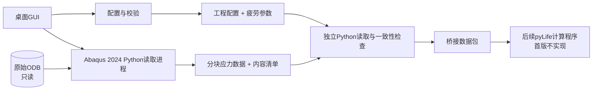

# ODB—pyLife 桌面桥接工具 PRD

版本：v0.1 草案｜日期：2026-11-15｜状态：需求确认稿，尚未授权进入代码实现。

## 1. 产品目标与已确认事项

帮助工程人员通过桌面界面选择Abaqus ODB，筛选要保留的局部应力历程，设置单位和疲劳曲线参数，导出可由独立Python/pyLife工作流读取、检查和复用的数据包。

用户已确认：

| 项目 | 首版要求 |
|---|---|
| 操作系统 | Windows |
| 实际Abaqus版本 | **2024**；以用户后续补充的具体版本覆盖最初“2023或更早”选项 |
| 交互形式 | 桌面GUI：选择文件、填写参数、执行操作 |
| 模型类型 | 同时支持普通实体和壳单元 |
| 任务终点 | 读取ODB、筛选历程、设置和保存疲劳参数、导出pyLife数据包 |
| 不包含 | 首版不计算循环损伤和寿命 |

当前实施假设：GUI、Abaqus与ODB在同一台Windows电脑上；默认使用本地磁盘上的、已经完成写入的ODB。该部署方式属于建议，尚非用户明确确认。Windows具体版本、Abaqus 2024补丁号与代表性ODB将在开发前登记为验收环境。

## 2. 用户问题与成功标准

当前ODB只能在匹配的Abaqus运行环境读取，而pyLife运行在独立Python环境。用户不希望手工修改每份导出脚本，也不希望按截图或全模型最大值拼接疲劳历程。

首版成功意味着用户可以完成以下闭环：

**选ODB → 识别可用内容 → 选步骤/区域/帧与截面点 → 预览固定材料点历程 → 设置单位与疲劳参数 → 校验 → 导出 → 在独立Python中重读并核对。**

“桥接成功”指数据和参数可被正确读取，不代表材料曲线适用、循环计数完成或寿命预测可信。

## 3. 首版边界

### 3.1 必须完成（P0）

- 单机、单ODB工程文件；每次导出选择一个时间域分析步。
- 实体与普通壳单元的积分点场应力读取；保留壳截面点，不默认混合上下表面。
- 多实例/单元集筛选、指定单元筛选、帧范围与步时间范围筛选。
- 原始应力分量、坐标系及材料点标识的无损保留；提供一个指定分量的历程预览。
- 单个疲劳参数组的手工录入、参数文件导入、单位归一化、校验与保存。
- 项目配置重开；可复核、可移动的数据包导出；独立读取适配器。
- 后台读取/导出、进度、取消、错误提示及日志。

### 3.2 后续扩展（P1）

- 多步连续时轴拼接、多ODB批处理、更多文件格式和更大规模优化。
- 多材料、多疲劳参数组的自动区域映射。
- 基于原始疲劳试验的曲线拟合、完整张量坐标变换与多轴评价。
- 载荷历史输出与场输出联合处理、网格/几何导出与三维浏览。
- 复材铺层、梁、接触/内聚单元、特殊单元、模态与频域复数结果。
- 远程Abaqus工作站、单文件EXE打包、旧Abaqus版本适配。

### 3.3 明确不做

不修改原ODB，不提交求解作业，不升级原文件，不替用户补造缺失变量；不做雨流计数、均值修正、Miner累计损伤、寿命云图或材料本构拟合；不把单帧场或某处峰值称为疲劳输入已充分。

## 4. 架构方案与建议

| 方案 | 描述 | 优点 | 代价/限制 |
|---|---|---|---|
| A：独立GUI + 原生读取进程（推荐） | GUI调用Abaqus Python的`odbAccess`，通过文件交接给现代Python/pyLife | 环境隔离；数据契约清晰；可直接保留积分点/截面点 | 需要编写专用读取与导出适配器 |
| B：GUI + pylife-odbclient/odbserver | 复用pyLife客户端/服务端 | 有现成查询接口 | 需配置两侧包及版本；仍需核对输出位置与材料点完整性 |
| C：Abaqus/CAE内置插件 | 在CAE内提供界面 | 直接使用已有模型环境 | 依赖CAE生命周期，和独立pyLife运行环境耦合更深 |

推荐A，B留作后续可替换后端。推荐原因是本项目已有通用导出skill，但其CSV不含完整积分点/截面点标识；首版需要明确可检查的数据接口。**该选型为编写者建议，等待PRD确认，不将其写成用户已批准的实现。**

Abaqus 2024已经切换到Python 3.10系列，不能继续按2023的Python 2.7假设设计首版。仍将GUI/pyLife和Abaqus运行环境隔离，不往Abaqus自带Python中混装GUI、pandas或pyLife依赖。[S1]



GUI框架在详细设计时确定，默认建议使用带标准文件选择器、表格和异步任务能力的桌面框架。框架选择不改变下面的业务和数据契约。首版以源码/环境安装方式交付，不承诺先打包成EXE。

## 5. 用户流程和页面

采用五步向导，步骤可返回修改；已生成的数据是否仍有效由依赖关系决定，而非一律重新读取。

| 页面 | 用户操作 | 界面反馈 |
|---|---|---|
| ① 文件与环境 | 配置Abaqus启动程序、测试连接、选择ODB | 实际运行版本、文件状态、是否可以只读打开 |
| ② 数据选择 | 选分析步、实例、单元集/单元、帧或步时间范围、壳截面点 | 可用字段、实体/壳类型、选中范围、预计工作量 |
| ③ 预览与单位 | 选一个材料点和实际存在的应力分量，确认应力/时间单位 | 固定点历程曲线、原值与换算值、缺失/非有限数据提示 |
| ④ 疲劳参数 | 录入或导入曲线参数与适用工况，确认材料归属 | 参数有效性、曲线预览、假设与未确认项 |
| ⑤ 校验与导出 | 选择导出类型和目录，查看检查结果，执行导出 | 当前阶段/进度、问题清单、输出路径与完成状态 |

预览是二维历程和数据表，首版不提供三维应力云图。显示最少必要信息；积分点等技术字段在数据选择/预览中可查，普通文件页面不展示内部进程协议。

界面底部提供：返回、下一步/校验、保存工程、取消当前任务。导出前汇总ODB、分析步、区域、帧范围、单位、截面点与参数状态，防止误用上次工程的设置。

## 6. 功能需求与验收条件

### FR-01 环境配置与探测

- 可以浏览选择实际Abaqus启动程序，保存到本机设置；不要求用户修改系统PATH。
- “测试连接”启动独立Abaqus Python，获取版本并测试`odbAccess`导入；不要求启动CAE窗口。
- 将启动程序不存在、命令失败、`odbAccess`不可用、版本不在首版范围分别提示。
- 主验收目标为用户的Abaqus 2024环境。较旧/较新版本不宣称支持，仅给出明确版本提示。
- Windows中文与空格路径列入验收；不把拼接任意命令作为用户操作入口。

### FR-02 ODB只读导入与内容扫描

- 首次扫描仅列出元数据及所需索引，不默认加载全部场历程。
- 列出ODB创建信息、分析步和domain、帧号/步时间、实例、单元类型、单元集、变量/分量、输出位置及截面点。
- 文件不存在、不可读、损坏、版本不匹配、仍在写入时不进入正常导出流程。
- 原ODB只读打开。旧文件若需要升级，仅说明需先生成兼容副本；首版不内置升级操作。新版本ODB不能由更旧运行时读取时明确报错。[S2]
- 源文件的大小或修改时间在处理期间变化时，使本次结果失效，不将其作为已完成数据包。

### FR-03 范围与历程筛选

- 每次选择一个时间域分析步，保留原始帧顺序与`frame_id`、`step_time`；不把静力步伪时间直接当作服务秒数。
- 支持实例范围、单元集并集和显式单元号；实例内编号可重复，跨实例不得合并同号单元。
- 不支持的单元类型或非时间域数据可见但禁选，说明原因；不能静默丢弃混合区域中的特殊单元。
- 实体保留全部被选积分点；壳截面点以ODB实际编号和描述列出，可选单点或全部，不默认取最大值/平均值。
- 支持连续帧区间及闭区间步时间筛选，导出元数据记录实际选中的帧；首版不提供自动降采样。
- 更换ODB、分析步或区域后，清除失效选择与缓存；不沿用不存在的单元/截面点。

### FR-04 数据提取、保真与预览

- 必须导出应力`S`，并以ODB实际`componentLabels`识别分量，不假设所有实体/壳都具有相同六分量布局。
- 每条记录保留实例、单元、积分点、截面点、帧号、输出位置、原始坐标系与应力分量。
- 不做节点平均、积分点平均、跨截面点最大值合并，也不按“每帧全模型最大值”生成历程。
- P0保留原始基底和局部坐标信息；若选择的分量基底随时间变化或不同点基底不可比较，原始数据可导出，但阻止将该分量标记为可直接用于pyLife的标量序列。完整张量统一坐标变换属于P1。
- 缺失分量保留缺失/可用标记，不能无依据补零。平面应力等补全属于有明确假设和验收样例的后续适配。
- 预览只针对用户选中的固定材料点；点的壳截面点必须可见。表格限定预览行数，曲线预览不改变导出的原始采样。
- 原始数据中有NaN、缺帧、删除单元导致的截断或空区域时，列出具体问题，不插值、不填充上一值、不静默丢行。
- `STATUS`存在时保留该标志；数据包中的原始行不因失效状态被静默删除。删除/失效后的行标记不可直接用于下游，数据准备状态据此判断。`STATUS`未输出时记录“未提供”，不自动假设所有点一直有效。

### FR-05 单位与时间含义

- ODB通常不提供可直接依赖的完整单位体系，源应力和时间单位由用户显式确认；未确认时不能给数据贴上MPa或秒的标签。
- 支持源应力Pa/kPa/MPa/N·mm⁻²，标准化应力为MPa；标准化时间为秒仅在用户确认其为物理时间并给出单位时执行。
- 时间含义选择“物理时间 / 加载参数（伪时间） / 未确认”。保留原`step_time`；伪时间和未知时间不计算物理频率、不自动导出工作小时。
- 疲劳参数与应力使用同一目标单位；单位设置变化后，预览和参数换算必须重新校验，不能对已换算数值重复换算。
- 原始值、源单位、换算系数和标准值可追溯。温度作为曲线适用条件记录；首版不导出温度场或执行温度修正。

### FR-06 疲劳参数设置

首版一个导出包最多关联一个疲劳参数组。可以仅导出原始桥接数据而不填疲劳参数；用户需显式确认参数对应选定区域的材料/成型状态。不同材料区域不自动共用一组参数。

支持两种手工录入方式，以及同结构参数文件的JSON导入：

| 方式 | 输入 | 校验与保存 |
|---|---|---|
| pyLife曲线参数 | `k_1, ND, SD`与低幅段行为 | 有限正数；保存应力定义、单位和有效范围 |
| Basquin形式 | `S_a=A N^b`或`S_a=A(2N)^b`，`A,b`与参考循环数`N_ref` | `A>0,b<0,N_ref>0`；`k_1=-1/b`，参考点按所选N/2N约定计算 |

共同字段：材料名称/标识、工艺说明、参考R、温度与频率适用条件、数据来源、实测/适用应力或寿命范围、备注。

- 默认“不声明无限寿命”，低幅段以显式有限斜率表示；`ND/SD`可作为曲线参考点，不自动命名为已验证疲劳极限。
- 有限低幅段必须输入正的有限`k_2`；若采用单一Basquin直线，明确设置`k_2=k_1`。曲线标准应力定义为幅值；导入范围定义的数据时，须显式确认并按幅值=范围/2转换，保留原定义与换算记录。
- 选择“假设无限寿命段”时必须显式确认并保存依据与假设标签；不把无限值写成非法JSON数字。
- 散布`TN/TS`及失效概率为可选元数据；未提供时标记未知，不宣称具备概率寿命模型。
- 首版只预览和校验曲线，不从原始疲劳试验拟合，不执行均值/温度/频率修正。
- 单轴应力比统一`R=σmin/σmax`；R是材料曲线参考条件，不假定整个ODB历程都符合该R。
- 曲线预览标出有效范围与外推段。可显示当前标量历程幅度包络，但不把它当作已完成雨流后的循环分布。[S3、S4]

### FR-07 工程配置与重开

- 保存ODB引用、源文件大小/修改时间指纹、分析步、区域/帧/截面点选择、单位、时间含义和疲劳参数；配置自带schema版本。
- 重开后先核对ODB指纹及内容，发现文件已移动允许重新定位；发现源内容变化要求重新扫描。
- 文件选择/范围变化使数据缓存失效；仅更改参数备注不触发ODB重读；单位变化重算标准值但不重读原文件。
- 本机启动程序路径和可移动的导出包分开保存；分享包不要求保留原电脑的绝对路径。

### FR-08 校验、导出与重读

提供两种明确模式：

1. **原始桥接包**：可以保留未确认单位、坐标或参数，但问题必须写入检查报告；不称为疲劳计算就绪。
2. **pyLife准备包**：源应力单位已确认，选定分量存在且有限，材料点/帧键唯一，时间顺序明确、至少两个有效时刻，基底一致或可证明固定，参数合法且材料归属已确认。它仍不保证包含完整循环或满足疲劳模型假设。

导出为一个目录；压缩不是P0必需项。包含元数据、分块CSV、点索引、配置、可选曲线参数与检查报告。这里的“pyLife数据包”是**本项目定义的交换格式，不是pyLife官方通用文件标准**。

在独立Python环境提供读取适配器接口：加载长表/指定材料点序列、曲线参数和元数据，构造pandas数据结构，并验证与锁定pyLife版本的参数契约。没有循环计数时不构造伪造的`LoadCollective`。

完成条件：文件都写完、行数及键检查通过、清单/校验值生成、独立重读一致。任何失败或取消都不能产生标为完成的包。

## 7. 数据包契约（v1）

```text
bridge_bundle/
  manifest.json              schema、来源、选择、单位、行数、文件与SHA-256
  odb_inventory.json         可用步骤、区域、变量、分量和截面点
  points.csv                 固定材料点索引
  fields/part-000001.csv      分块场历程，按帧和固定材料点标识保存
  project_config.json        可复用业务配置，不含本机启动程序设置
  fatigue_parameters.json    仅关联参数时生成
  validation.json            错误/警告、原始或准备模式及各项检查结果
  README.md                  单位、限制、重读方式和后续pyLife使用说明
```

`point_id`在包内稳定且唯一，身份由下列字段组成：

```text
instance_name + element_label + integration_point + section_point_number
```

无截面点时使用显式空值语义；截面点描述不是唯一主键。`frame_id`只在已选分析步内解释。

| 表 | 必需字段 |
|---|---|
| `points` | point_id、实例、单元号、积分点、截面点编号/描述、单元类型、输出位置 |
| `fields` | point_id、frame_id、step_time、实际应力分量、坐标基底/变换信息、数据有效性标志；有STATUS时另保留 |
| `manifest` | schema版本、ODB指纹、Abaqus与适配器版本、选定分析步domain、筛选规则、单位/时间含义、字段定义、文件清单、行数与哈希 |
| `fatigue_parameters` | schema版本、参数表达式与N/2N约定、标准单位参数、低幅段行为、有效范围、材料/工况/来源与假设 |

原始数据分量按实际标签保存；标准化值和原值的列名/单位在manifest中明确对应。坐标系矩阵等结构化信息可用独立JSON索引引用，不能仅写一个无定义的字符串“local”。

## 8. 状态与异常规则

正常状态：未配置 → 环境可用 → 已扫描 → 已选择 → 已预览/确认单位 → 已校验 → 导出中 → 导出完成。

后台任务状态：空闲、运行、取消请求、已取消、失败、成功。导出完成与单纯后台进程退出必须分开判断。

| 异常 | 产品处理 |
|---|---|
| Abaqus路径错误/odbAccess不可用 | 停止扫描，回到环境设置，保留用户输入 |
| ODB不兼容或损坏 | 不升级原文件；显示可执行的下一步与日志 |
| ODB仍在写入或处理期间变化 | 不生成完成包；保留诊断，要求稳定文件副本 |
| 没有S、没有积分点场输出 | 不伪造数据；说明需要重新设置求解输出 |
| 选中帧缺变量或点出现缺口 | 原始包可带问题导出；准备包阻止受影响选择 |
| 只有一帧 | 允许原始包；阻止作为历程准备包 |
| NaN/Inf、重复键、乱序 | 不静默清理；给出材料点/帧示例和数量 |
| 参数或单位错误 | 定位字段；允许先保存草稿但不导出准备包 |
| 用户取消/磁盘满/进程崩溃 | 只清理本工具创建的临时文件；原ODB和已有导出不变 |
| 输出目录已存在 | 默认创建新名称，需用户显式选择才覆盖本工具旧包 |

导出先写新临时目录，成功后才发布完成目录。取消只终止本工具启动的读取进程，不关闭用户独立运行的CAE或求解作业。

## 9. 非功能要求

- **只读与可追溯**：不改ODB内容；测试样例以导入前后SHA-256验证。运行时指纹检查不强制每次完整哈希大型ODB。
- **界面响应**：扫描/导出不得运行在GUI主线程；点击取消立即显示“取消请求”，长ODB调用未返回时明确状态，必要时终止专属子进程。
- **容量策略**：按帧/区域分块，不把全ODB放入GUI内存；预览只读限定材料点。先验收100万行级导出及用户代表性ODB，再声明更大容量。
- **进度真实性**：扫描未知工作量时显示阶段与已处理数量，不伪造百分比；能确定帧/分块数后显示实际进度。
- **离线运行**：读取和导出不需要互联网，不自动上传ODB或数据。
- **数值保真**：采用足够的文本精度保留双精度数据，区分缺失与零；单精度源数据不宣称提升精度。
- **可重现**：配置、导出schema、Abaqus和Python/pyLife版本可追踪；同一源文件与配置导出语义一致。

## 10. 技术实现建议与现有skill的用途

仅为详细设计输入，不是已实现代码：

- GUI/协调层：管理向导状态、任务调度、设置、预览与导出，不直接加载Abaqus二进制库。
- Abaqus读取层：原生`odbAccess`，只读扫描和分块提取；由目标Abaqus Python运行。
- 数据契约层：校验主键、时间、坐标、单位、分量及数据包schema。
- pyLife适配层：在独立环境重读为pandas对象并确认曲线结构；首版不计算损伤。
- 首版优先原生文件桥接，不将OdbClient默认输出直接视为完整积分点数据。[S5]

现有`abaqus-odb-extract`可参考环境探测、逐帧访问与日志，但当前字段表仅`instance,label,position,value`，默认末帧；需新增完整材料点导出，不能将现脚本包装GUI后就宣称需求已满足。

`abaqus-version-compat`用于版本检测与错误解释；Jason疲劳skill用于参数概念检查，不能沿用其金属示例常数。Science Superpowers用于已知答案校核和数据追溯，不替代真实Windows/Abaqus验收。

## 11. 验收矩阵

| 编号 | 样例/操作 | 通过条件 |
|---|---|---|
| AT-01 | 用户Windows + Abaqus 2024环境 | 可配置启动程序，探测实际版本并读ODB |
| AT-02 | 同号单元位于两个实例 | 点键不同，数据不混并 |
| AT-03 | 多积分点实体 | 每个积分点保持独立；与Abaqus抽查分量一致 |
| AT-04 | 上下表面壳 | 截面点可选；不同点历程分别保留，不平均 |
| AT-05 | 多步ODB | 选一步仅导该步；不同domain不能误当时间历程 |
| AT-06 | 仅单帧/缺S/缺帧/删除单元 | 按第8节阻止或标记，不补造历程 |
| AT-07 | 中文、空格路径 | 文件选择、进程启动、读取、配置重开和导出均通过 |
| AT-08 | 单位与N/2N参数转换 | 用已知数值手算对比，不能出现倍数或二次换算错误 |
| AT-09 | 局部/旋转基底 | 原始基底可复核；不满足一致性时不标记标量准备就绪 |
| AT-10 | 用户取消、磁盘错误、子进程失败 | 原ODB不变，无假完成包，可再次开始新任务 |
| AT-11 | 导出包移动到另一目录 | 不依赖原绝对路径即可独立重读数据与参数 |
| AT-12 | 100万行与代表性ODB | GUI保持响应，分块导出正确；记录耗时、内存和磁盘量，不用虚构性能数字 |
| AT-13 | 完整往返检查 | 行数、主键、分量、选帧、单位、曲线参数与独立重读一致 |
| AT-14 | 原ODB完整性 | 验收样例导入前后文件哈希一致 |

数值比较容差根据源单/双精度与具体导出精度固定在实现验收方案中；不能只凭曲线外观判断一致。

## 12. 开发前确认与默认决策

用户已经确定Windows、Abaqus 2024、GUI、实体+壳及“不计算寿命”的范围，无需重复确认。

当前提交评审的建议：

1. 采用方案A，即独立GUI + 原生读取进程，首版同机运行。
2. 每次导出一个时间域分析步、一个参数组；完整保留实体积分点与普通壳截面点。
3. 首版用目录式CSV+JSON交换包，提供独立读取适配器，不先做EXE和三维云图。
4. 支持原始桥接包与参数/数据校验更严格的准备包；后者也不等同于疲劳计算已验证。

PRD批准后再制定实现计划和测试样例。当前没有编写桥接工具代码、安装GUI依赖或运行用户ODB。

## 13. 来源

- **S1** [SIMULIA Abaqus Python 3 Update](https://3dswym.3dexperience.3ds.com/wiki/simulia-community/abaqus-python-3-update_Jh6mYnf4RwWRxe1OF4pxQw)：2024 Python版本切换。
- **S2** [ODB顶层命令与版本异常](https://docs.software.vt.edu/abaqusv2025/English/SIMACAEKERRefMap/simaker-c-odbopenodbcommandcpp.htm)：只读和版本异常的参考；实际Python调用以2024运行时验证。
- **S3** [pyLife 2.3.1 WoehlerCurve](https://pylife.readthedocs.io/en/2.3.1/materiallaws/woehlercurve.html)：曲线参数与低幅段缺省行为。
- **S4** [pyLife疲劳数据拟合说明](https://pylife.readthedocs.io/en/2.3.1/demos/woehler_analyzer.html)：曲线与试验数据概念；拟合不纳入首版。
- **S5** [OdbClient](https://pylife.readthedocs.io/en/2.3.1/tools/odbclient/odbclient.html)、[odbserver](https://pylife.readthedocs.io/en/stable/tools/odbserver/index.html)：双环境桥接与版本配置。
- 项目已安装skill及固定版本见[skills.lock.json](../../../skills.lock.json)；技术路线见[technical-route.md](../../technical-route.md)。
