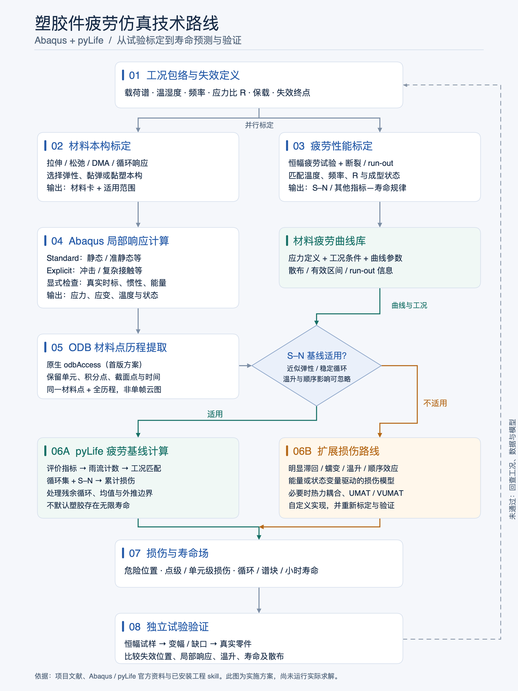
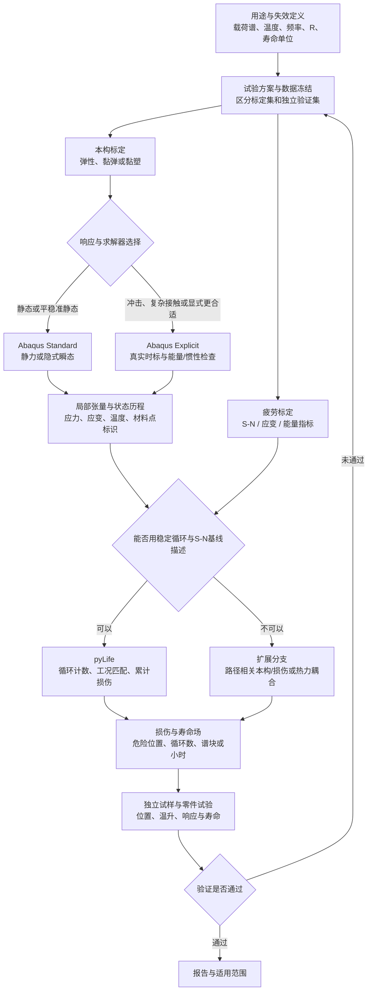

# 塑胶件疲劳仿真技术路线：Abaqus + pyLife

版本：2026-11-17，技术路线工作稿。依据本项目已归档文献、Abaqus与pyLife官方文档、已安装skill及其脚本检查整理。本文是实施设计，不是已完成的仿真结果或已冻结的试验计划。

## 1. 推荐主线与适用边界

建议主线：**明确使用/测试工况和失效定义 → 标定材料本构与疲劳规律 → 选择求解器 → 求取局部响应历程 → 提取并校验材料点数据 → pyLife循环与损伤计算 → 寿命映射 → 独立试验验证。**

本构与工况需要迭代确认：先确定工况包络，用它决定材料试验的温度、应变率和循环范围，再选定本构。不能在不知道频率和温度的情况下先固定一个材料模型。

以下三个对象须分开：

- **材料本构**：给定加载路径时，应力、应变、内部状态及温度如何变化，用于有限元局部响应。
- **疲劳规律**：在已定义条件下，某个循环指标与失效寿命如何关联，来自疲劳试验与模型标定。
- **累计损伤规则**：不同循环或路径如何共同消耗寿命；Miner只是一种待验证基线。

仅有弹性模量、泊松比、拉伸强度或一张最大应力云图，不能闭合疲劳寿命计算。pyLife在本路线中的角色主要是材料曲线、循环统计与损伤评估；它不是无需材料疲劳数据的通用塑胶失效求解器。[S1–S4]

## 2. 路线总图



[查看可编辑SVG矢量版](assets/technical-route.svg)。蓝色部分为输入与机械响应，绿色为S-N疲劳基线，橙色为复杂响应下的扩展路线；虚线表示验证反馈。

**图中第05步的实现边界**：OdbClient 是后续待评估选项，并不表示已支持完整壳截面点。当前对 pyLife 2.3.1 服务端的静态检查发现，字段索引未显式包含截面点，部分网格查询限制实体单元；首版应优先验证 Abaqus 原生 `odbAccess` 导出，并用真实实体和壳 ODB 核对。上述桥接及疲劳流程目前均非已完成的实际零件求解。

<details>
<summary>Mermaid结构源图</summary>



</details>

该图是本项目对来源资料的工程综合。Explicit是可选机械响应求解器，并不等同于疲劳寿命模型。

## 3. 各阶段如何实现

| 阶段 | 具体工作 | 实现形式 | 交付物与进入下一阶段的条件 |
|---|---|---|---|
| 0 工况与判据 | 明确对象、加载、环境、失效及目标寿命 | 需求表、原始载荷文件、工况配置 | `case_spec`；能将试验与仿真中的“失效”对应起来 |
| 1 材料响应 | 标定弹性、黏弹、黏塑等必要响应 | 拉伸/循环/松弛/DMA数据；Python拟合；Abaqus材料卡 | 本构参数及适用范围；单元/试样响应可复现 |
| 2 疲劳性能 | 获取相应R、温度和频率下的疲劳规律 | 恒幅疲劳试验；保留run-out；pyLife或专用拟合 | S-N或其他疲劳指标曲线、散布、数据边界 |
| 3 有限元 | 建立几何、接触、载荷、预紧及网格，选择Standard/Explicit | Abaqus Python批处理，`.inp/.cae`与求解日志 | 响应、网格和时间输出收敛；Explicit还需惯性/能量检查 |
| 4 数据桥接 | 提取相同材料点的完整历程 | 首版原生`odbAccess`导出；后续可适配OdbClient | `point_history`、网格、单位与来源元数据；不得跨材料点拼接 |
| 5 疲劳计算 | 循环计数、均值/环境匹配、累计损伤 | 独立Python环境调用pyLife；必要部分自定义 | 每材料点循环集、谱块损伤、寿命与适用性标记 |
| 6 场映射 | 将点级损伤与寿命映射回单元/表面 | VTK/PyVista/ParaView；必要时写结果副本 | 危险区和寿命分布；不覆盖原始ODB |
| 7 验证 | 用未参与标定的数据检验预测 | 恒幅→变幅→缺口试样→零件 | 误差、散布、位置与失效机理可接受，方可形成设计依据 |

表中程序与数据对象是**拟实现模块**，并非当前已存在的计算程序。

## 4. 工况与失效定义先行

必须记录：

1. 材料牌号、是否增强、成型方式、厚度、熔接痕/纤维取向及状态调节。
2. 力/位移/压力/加速度控制方式，各通道的时间序列和相位关系。
3. 温湿度、频率、波形、保载、停顿、装配预紧、接触和摩擦。
4. 失效终点：可见裂纹、指定裂纹尺寸、完全断裂或刚度下降；选定后用于本构/疲劳试验和零件验证的一致比较。
5. 寿命单位：完整循环、工况重复次数、谱块或工作小时；注明一个谱块的实际持续时间。

对单轴循环统一定义：

\[
R=\sigma_{\min}/\sigma_{\max},\qquad
\sigma_a=(\sigma_{\max}-\sigma_{\min})/2,\qquad
\sigma_m=(\sigma_{\max}+\sigma_{\min})/2.
\]

应力幅与范围差两倍。文献所用名义应力、局部应力和应力比应逐一核对；局部有限元应力集中不能和已包含缺口效应的结构S-N曲线重复计入。

## 5. 材料本构与疲劳参数分别标定

### 5.1 本构如何选

| 试验观察 | 候选本构 | 最小验证内容 |
|---|---|---|
| 目标应变范围近似线性，速率/滞回影响可忽略 | 线弹性，按需含温度或方向依赖 | 对应温度与速率的刚度、局部应变和载荷—位移 |
| 松弛、频率依赖与可恢复滞回明显 | 与适当弹性响应组合的时间域黏弹，例如Prony表示 | 松弛或DMA拟合，并用独立循环试验验证相位与滞回 |
| 不可恢复应变、循环棘轮、明显屈服或非线性黏流 | 经试验验证的内置模型或UMAT/VUMAT | 拉/压、速率、循环累积与卸载路径，含状态变量验证 |
| 弹性体大变形或短纤增强材料 | 相应的大变形或各向异性分支 | 不沿用未增强热塑性材料的默认模型与疲劳准则 |

采用复杂本构的依据是实测响应，不能只看材料名称。Abaqus时间域黏弹与其他材料行为有兼容性约束；不要直接把`VISCOELASTIC`和任意塑性模型叠加。[S5、S6]

### 5.2 疲劳试验与曲线

首版用目标工况的恒幅疲劳作为基线。单轴/弯曲试验分别参考已归档ASTM D7791与D7774的适用范围，具体程序以持有授权的标准全文为准。

- 在实际寿命区间设置多个应力水平并重复试验；重复数根据散布、置信区间目标与预算确定，不能在材料数据缺失时宣称试样数已足够。
- 同步记录温度、位移/应变和滞回随循环的变化，区别机械疲劳、热软化和蠕变主导失效。
- 数据包含`load`、`cycles`和`fracture`。`fracture=False`代表达到终止循环数仍未断裂，不是该循环数发生断裂。[S2]
- 独立验证试样在拟合前划分，验证数据不参与参数选择或临界损伤调节。
- 若工作R、温度、频率变化，应以相应数据建立分条件曲线或已验证的修正关系。仅一条室温S-N曲线不能自动覆盖全部环境。[P1–P3]

本构拟合正确不意味着疲劳曲线正确；同样，拟合了S-N也不说明有限元能准确给出局部响应。

## 6. Abaqus/Explicit如何接入

### 6.1 选型原则

用户提出的Explicit路线可以采用，条件是它适合机械响应问题，并通过验证。平稳、缓慢且惯性不重要的加载应同时评估Standard路线的成本；复杂接触、冲击或明显瞬态问题可选择Explicit。振动/共振问题应保留真实动力学，不能套用准静态的能量判据。

Explicit不必逐周期求解全部寿命：若局部响应在重复加载下达到可验证的稳定周期，机械计算可提供代表性历程，由后处理评估重复寿命。如果应变、温度或内部状态持续漂移，则不能复制一次循环直到失效，需要考虑循环演化或路径相关模型。

### 6.2 实施顺序

1. 先做对应材料的单元与试样算例，复现实测响应。
2. 建立零件网格、装配状态、接触、预紧和真实载荷时序。
3. 估算稳定时间增量和计算成本，执行datacheck，检查控制时间步的单元。
4. 按真实加载时标运行，识别初始过渡与周期响应；用连续周期的峰值、均值、滞回与温度变化判断是否可视为稳定，稳定容差在正式计算前约定。
5. 完成网格、输出采样、质量缩放和机械响应验证后，才导出疲劳历程。

对于速率相关塑胶，**不能单纯缩短加载时间来加速计算**。质量缩放可以保留物理时标，但仍需证明附加惯性没有显著改变局部响应；真实动力问题还需正确保留质量与惯量。[S7]

### 6.3 输出与检查

- 场输出：`S`，按本构和分析需要选择的应变、温度、状态变量与损伤/失效状态；变量名和可用位置以实际版本与单元为准。
- 历史输出：加载点力/位移/接触量、温度和能量。Explicit检查`ALLKE`、`ALLIE`、`ALLAE`、`ETOTAL`及质量缩放相关量。
- 准静态判定结合动能/内能、反力平衡和局部响应比较。skill中的约5–10%量级只是筛查经验，不是普适验收标准；内能接近零的初始时段和刚体动能不能机械地用于比值判定。
- 真正的动态分析不要求动能很小，应检验能量收支、冲量、响应频率和试验对照。
- 加密输出频率，直到峰谷、计数和累计损伤对采样的变化达到预先约定的容差。求解内部步长很小不代表ODB输出已足够密。

## 7. Abaqus到pyLife的数据接口

### 7.1 首版推荐实现

**Abaqus端用原生`odbAccess`导出文件，现代Python环境读取后调用pyLife。** 两个环境以文件连接，便于排查版本与接口问题。后续可增加`pylife-odbclient/odbserver`直接访问，但应确认客户端/服务端版本及输出位置。[S8、S9]

当前`abaqus-odb-extract` skill可以用于探测ODB和检查数值；其脚本默认取末帧，必须显式请求完整历程。检查当前固定版本源码发现：场CSV输出只有`instance,label,position,value`，**没有积分点和截面点编号**。因此不能直接把此表视为已完成的疲劳接口；需要新增专用导出器，保留完整材料点键和张量分量。

推荐主键：

```text
run_id + instance + element_id + integration_point + section_point
```

再加`step_id`、`frame_id`、`time_global_s`索引每一时刻。壳单元上下表面不能混合，多积分点不能只按单元编号合并。

### 7.2 数据契约

| 数据对象 | 建议字段 | 用途 |
|---|---|---|
| 运行元数据 | 单位、材料卡版本、Abaqus/pyLife版本、载荷谱版本、坐标系、输出位置、损伤方法 | 使结果可追溯 |
| 局部历程 | 材料点主键、全局时间、`S11,S22,S33,S12,S13,S23`；按需附应变、温度、状态 | 循环或路径损伤计算 |
| 网格 | 节点坐标、单元连接、材料/区域/截面标识 | 结果映射 |
| 疲劳曲线 | 材料/条件ID、温度、频率范围、R、应力定义、曲线参数、概率与有效区间 | 正确匹配曲线 |
| 循环集 | 材料点ID、幅值、均值、完整/半循环权重、谱块ID，必要时循环位置 | pyLife输入及审计 |
| 结果 | 点级损伤、寿命、寿命单位、危险指标、曲线ID、外推/不适用标记 | 展示和验证 |

归档格式可从CSV+JSON开始；大规模场历程改用Parquet或HDF5并按材料点/区域分块。文件类型属于实施选择，不改变上述数据含义。

应变数据必须记录张量剪应变还是工程剪应变。采用能量法时还需保证应力/应变率的功共轭与体积定义，不能随意把`S`和某个应变输出相乘。热量、温度和能量单位须另做闭合检查；熵相关计算使用绝对温度。

## 8. pyLife疲劳计算怎么实现

### 8.1 先确认评价量

单轴或近似比例加载，可先验证与材料试验一致的应力分量或已选定的有符号指标。不能默认把每帧非负Mises值做雨流就代表拉压循环；旋转主应力、剪切和非比例多轴加载需要经验证的准则或临界平面等扩展。

先保留完整应力张量，后选疲劳指标。不能把随时间跳动的“全模型最大应力位置”拼成一条历程；应对每个固定材料点分别计数，再比较损伤。

### 8.2 曲线准备

可通过`pylife.materialdata.woehler`拟合，并使用`WoehlerCurve`/`Fatigue`等结构计算。若使用有限寿命段

\[
\sigma_a=A N^b,\quad b<0,
\]

则与pyLife正斜率表示的转换为`k_1=-1/b`。必须同时核对原文用的是`N`还是`2N`，以及输入是幅值还是范围。

pyLife曲线的`ND/SD`是模型参数；默认缺少`k_2`会采用无限斜率的低幅段。**软件的这一默认不能证明塑胶存在无限寿命。** 单一Basquin基线可显式采用相同斜率延伸（`k_2=k_1`），并限定/标记外推区间；若采用拐点或低幅段，须有数据或明确工程假设支持。[S3]

### 8.3 循环计数与工况匹配

1. 按固定材料点和连续时间顺序准备评价历程，检查缺帧、重复时间与NaN。
2. 用`pylife.stress.rainflow`计数；需要关联温度/时间时选择保留循环位置的记录方式。
3. 明确有限时程的残余/半循环和重复谱块边界处理，用已知简单波形验证计数，不能默认一次调用已闭合全部残余。
4. 从每个循环得到幅值、均值和权重；匹配材料曲线的R、温度、频率与应力定义。
5. 相同R条件可直接使用对应试验曲线；跨R条件优先用多R试验建立关系。Goodman/FKM示例参数不得未经验证直接移植到塑胶。

雨流模块提供循环检测与记录，温度归属、频率估计、曲线插值、残余处理和多轴评价仍需要本项目明确实现并验证。[S4]

### 8.4 损伤与寿命

作为首版基线，选定并记录Miner变体，计算材料点`j`在一个谱块中的损伤：

\[
D_{j,\mathrm{block}}=\sum_i\frac{n_{j,i}}{N_f(\sigma_{a,j,i},\sigma_{m,j,i},T,f,\ldots)}.
\]

其中`n`可包含半循环权重；`N_f`来自已匹配工况的曲线，而不是凭静强度推算。

若谱块可重复、局部状态和每块损伤近似不变，则有：

\[
B_{f,j}=D_{\mathrm{crit}}/D_{j,\mathrm{block}},\qquad
t_{f,j}=B_{f,j}t_{\mathrm{block}}.
\]

`B_f`是谱块次数，不是循环数。若每块含`n_block`个已定义循环，才能进一步换算循环寿命。临界损伤取1仅是基线假设，需通过试验验证；出现零损伤/数值无穷寿命时应检查曲线默认与适用区间，而非直接报告无限寿命。[S1]

计算初始过渡损伤时应单独计入，不能不加说明地丢弃；如果状态随谱块持续演变，上述线性重复折算不适用。

### 8.5 结果形式

- 点级/单元级损伤与寿命分布，保留积分点和截面点；展示时取最危险点或其他预定义聚合方式。
- 最危险位置、主要损伤循环来源、各工况贡献及曲线外推标记。
- 低置信度/数据不足区域。只有散布与概率模型有依据时，才输出指定失效概率的寿命；50%曲线不能直接称为设计许用寿命。
- 改型方案比较需采用同样工况、同样材料依据和同样评价方法。

## 9. 何时转入扩展路线

| 触发证据 | 扩展措施 | pyLife角色 |
|---|---|---|
| 局部温升足以改变响应或寿命 | 测量温升；验证耗散热源及传热；必要时热力耦合并更新材料/疲劳参数 | 仍可处理经验证的分条件曲线；不能只给室温曲线加一个任意温度系数 |
| 持续滞回演变、棘轮或循环蠕变 | 标定循环非线性响应；评估应变/耗散能/其他指标 | 基础数据处理可复用，指标—寿命与状态演化需要自定义 |
| 高低载顺序或保载导致基线明显失效 | 使用保留路径记忆的损伤模型；UMAT/VUMAT或外部状态更新 | 不把已丢失顺序的雨流直方图当作完整历史 |
| 已有裂纹且关心扩展寿命 | 转裂纹扩展参数与驱动力路线，分别定义起裂和扩展终点 | 不把材料S-N直接等同于裂纹扩展律 |

聚合物自发热与疲劳耦合是已归档综述和DuPont技术论文强调的问题。[P3、P4] 2024年熵损伤论文可作为路径相关建模研究入口，但该文的单元级、恒温及加速假设不能直接升级为本项目零件通用模型；其UMAT实现也不是Explicit所需VUMAT的直接替代。[P5]

## 10. 程序模块划分与开发顺序

以下仅规定未来职责与文件名，不声称已开发：

```text
data/raw/                         原始材料、疲劳与载荷试验，不覆盖
data/processed/                   清洗数据、有效工况与参数
config/case_spec.json              工况、单位、失效判据、求解与评价选择
abaqus/build_model.py              几何/材料/载荷/网格/输出/作业
abaqus/check_job.py                日志、机械响应、能量与收敛检查
abaqus/export_point_history.py     材料点张量/温度/状态与网格导出
fatigue/fit_material_curve.py      疲劳数据与曲线拟合/有效范围
fatigue/prepare_cycles.py          固定点历程、评价指标、循环与谱块边界
fatigue/calculate_damage.py        工况匹配、损伤和寿命
fatigue/map_results.py             结果回映射与危险区
results/<run_id>/                  输入快照、环境、日志、结果与验证
```

建议按闭环而非按软件逐个开发：

1. **数学与接口基线**：解析单轴波形验证幅值/计数；恒幅循环验证`D=n/N_f`；手算校核谱块次数与小时换算；已知S-N数据验证拟合及`N/2N`转换。
2. **材料点闭环**：单元或均匀试样的真实材料响应→ODB导出→pyLife恒幅寿命，与同条件试验比较。
3. **缺口/简单结构闭环**：检查局部应变、网格与应力集中，再预测危险区及寿命。
4. **真实零件**：导入实测载荷谱、装配与环境；执行独立验证，确定是否需要扩展路线。

不会先用Explicit模拟百万个循环作为起步，也不在没有疲劳数据的情况下将完整流程演示称为寿命预测验证。

## 11. 验收与计算预算

### 11.1 分层验收

| 层级 | 要核验的内容 | 不能替代它的证据 |
|---|---|---|
| 数据/数学 | 恒幅与简单变幅的峰谷、循环、损伤、单位与手算一致 | 图形看起来合理 |
| 本构 | 独立工况下的刚度、相位/滞回、不可恢复应变 | 参数拟合残差很小 |
| 有限元 | 试样/零件反力与变形、网格/采样收敛，Explicit能量/惯性 | 作业显示Completed |
| 疲劳 | 未参与标定试样的寿命、散布、失效机制与位置 | 在拟合数据上重现S-N |
| 零件 | 代表工况下的温升、危险位置及寿命 | 只有单元级论文验证 |

正式试验前应记录误差目标、重复数依据、剔除规则和独立验证划分。当前没有真实材料/工况数据，故本文不伪造精度、寿命、置信区间或所需试样数。

### 11.2 预算控制

Explicit先估算`分析时长/稳定增量`的数量级；稳定增量受最小单元、波速、接触与材料状态影响。全场历程存储量随材料点数×输出时刻数×变量数增长，应先全场定位危险区，再对固定候选区域导出充分密集的完整历程，同时检查其他潜在危险位置没有被筛掉。

三类敏感性分开：空间网格、输出时间采样、质量缩放。只通过其中一项不能说明疲劳结果收敛。

## 12. skill如何真正参与实施

| 本地skill | 应用环节 | 已检查的边界 |
|---|---|---|
| `abaqus-model-builder` | 参数化建模与作业流程 | 上游算例不等于本项目材料已验证 |
| `abaqus-explicit-impact` | Explicit检查和能量/惯性诊断 | 准静态与真实动力不同；经验阈值不自动成为项目验收线 |
| `abaqus-odb-extract` | ODB探测与数值检查 | 默认末帧；当前场CSV缺积分点/截面点键，疲劳接口需扩展 |
| Jason `general`/`fatigue` | 脚本、S-N及应变寿命思路 | 示例含金属参数，不能照搬；以实际Abaqus内核确认语法 |
| Jason `abaqus_subroutine_skills` | 本构/路径损伤实现 | UMAT与VUMAT求解器和接口不同，需分别验证 |
| Science Superpowers | 数据流、标定/验证分离、已知答案校核与归档 | 当前为路线设计；正式确认性试验另定研究问题与冻结方案 |
| Nature阅读/绘图技能 | 后续论文证据卡、方法图和报告 | 不替代本构标定、求解或工程验证 |

安装54个目录只意味着资源可用。本路线没有将未运行的skill脚本标为本项目已验证成果。

## 13. 证据来源与阅读范围

### 官方技术依据

- **S1** [pyLife 2.3.1 Life time Calculation](https://pylife.readthedocs.io/en/2.3.1/demos/lifetime_calc.html)：局部应力、载荷集与Miner类计算的连接。示例均值修正及参数不是目标塑胶验证。
- **S2** [Wöhler analyzing functions](https://pylife.readthedocs.io/en/2.3.1/demos/woehler_analyzer.html)：输入`load/cycles/fracture`与曲线拟合。
- **S3** [WoehlerCurve API](https://pylife.readthedocs.io/en/2.3.1/materiallaws/woehlercurve.html)：`k_1/ND/SD/k_2`及缺省低幅段。
- **S4** [rainflow模块](https://pylife.readthedocs.io/en/2.3.1/stress/rainflow.html)：检测/记录与时间索引。
- **S5** [Abaqus Time Domain Viscoelasticity](https://docs.software.vt.edu/abaqusv2026/English/SIMACAEMATRefMap/simamat-c-timevisco.htm)：黏弹表征、适用分析与热耦合能力。
- **S6** [Combining Material Behaviors](https://docs.software.vt.edu/abaqusv2026/English/SIMACAEMATRefMap/simamat-c-matmodels.htm)：材料定义和兼容性约束。
- **S7** [Mass Scaling](https://docs.software.vt.edu/abaqusv2026/English/SIMACAEANLRefMap/simaanl-c-massscaling.htm)：速率相关材料保留自然时标、质量缩放与惯性影响。
- **S8** [Reading field output data](https://docs.software.vt.edu/abaqusv2026/English/SIMACAECMDRefMap/simacmd-c-odbintroreadfieldpyc.htm)：场输出位置、积分点/截面点与逐帧变量。
- **S9** [OdbClient API](https://pylife.readthedocs.io/en/2.3.1/tools/odbclient/odbclient.html)：客户端/服务端桥接和输出位置行为。

### 已归档研究资料

- **P1** Mortazavian等，频率与自发热：[10.1002/pen.24124](https://doi.org/10.1002/pen.24124)。当前仅摘要/在线元数据，PDF未获取；不引用未核对的完整参数表。
- **P2** Santharam等，多方向/R/环境疲劳准则：[10.1016/j.ijfatigue.2020.105574](https://doi.org/10.1016/j.ijfatigue.2020.105574)。已获取并阅读 HAL 作者稿正文，部分图表已核；该研究主要归并已有试验，部分指标取寿命中点，不应当作独立前瞻预测或 PC/ABS 精度证明。
- **P3** Katunin，自发热综述：[10.3390/polym11010019](https://doi.org/10.3390/polym11010019)。本地PDF与公开文献内容支持机制判断，不把综述当作材料参数。
- **P4** Volgers、Shojaei，[Fatigue Behavior of Engineering Polymers and Its Numerical Implementation](https://www.3ds.com/assets/invest/2024-01/2218-saoe-fatigue_behavior_of_engineering_polymers_and_its_numerical_implementation.pdf)。已查看本地PDF相关章节；POM案例用于方法参考。
- **P5** Li等，熵损伤变幅数值研究：[10.3390/polym16202857](https://doi.org/10.3390/polym16202857)。已查看方法相关内容，作为扩展研究路线而非通用设计模型。

全部资料及中文评注见[文献索引](../literature/README.md)，skill来源及固定版本见[技能说明](skills.md)与[skills.lock.json](../skills.lock.json)。

## 14. 下一步需要准备的项目输入

为将此路线变成可执行模型，首先提供或确认：**材料类型/牌号、零件几何与装配、实际载荷/频率和保载、温湿度、失效判据、已有材料/疲劳试验、可运行Abaqus的机器与版本。**

这些信息确定后，优先完成一个试样级的“本构→机械响应→点历程→疲劳→试验对照”闭环；它通过后，再进入完整零件模型。
